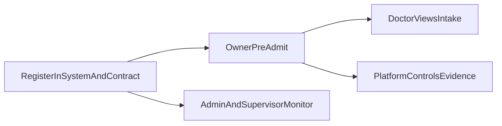

> **مسیر:** [مستندات — ایندکس](../README.md) › فرایندها  
> **پدر:** [مستندات — ایندکس](../README.md)

# فرایندهای کاری — نسخهٔ ۱

دامنهٔ این پوشه فقط **نسخهٔ اول** است: ثبت بیمار در سیستم و قرارداد، پیش‌پذیرش، مشاهده پیش‌پذیرش توسط پزشک، مانیتورینگ ادمین کلینیک و ناظر سازمان، و کنترل کامل ادمین کل (شامل GPS و عکس).

مفاهیم صف اتاق، نوبت، ایستگاه، پذیرش عملیاتی، پاراکلینیک و همراه در [`future/`](future/README.md) برای فازهای بعدی نگه داشته شده‌اند.

## جریان خلاصه v1

## نقش‌های نسخهٔ ۱

| نقش | شناسه | فایل یوزکیس |
|-----|--------|-------------|
| بازیگران و مرز سیستم | — | [use-cases/00-actors-and-system.md](use-cases/00-actors-and-system.md) |
| سلامتجو | `owner` | [use-cases/01-owner.md](use-cases/01-owner.md) |
| پزشک متخصص | `specialist` | [use-cases/02-specialist.md](use-cases/02-specialist.md) |
| ادمین کلینیک / بیمارستان | `admin` | [use-cases/03-admin.md](use-cases/03-admin.md) |
| ناظر / نماینده سازمان | `supervisor` | [use-cases/04-supervisor.md](use-cases/04-supervisor.md) |
| ادمین کل | `platform` | [use-cases/05-platform.md](use-cases/05-platform.md) |

## دیاگرام‌های فعالیت v1

| فرایند | فایل |
|--------|------|
| ثبت تا تکمیل پیش‌پذیرش | [activity-diagrams/01-register-to-preadmit.md](activity-diagrams/01-register-to-preadmit.md) |
| پزشک مرور پیش‌پذیرش | [activity-diagrams/02-doctor-reviews-intake.md](activity-diagrams/02-doctor-reviews-intake.md) |
| مانیتور ادمین و ناظر | [activity-diagrams/03-admin-supervisor-monitor.md](activity-diagrams/03-admin-supervisor-monitor.md) |
| شواهد GPS/عکس در پلتفرم | [activity-diagrams/04-platform-fraud-evidence.md](activity-diagrams/04-platform-fraud-evidence.md) |

## دروازهٔ تست قبل‌از‌انتشار

ماتریس اجرایی QA (Pass/Fail روی UCهای v1 + deploy smoke): [`../shared/pre-release-test-matrix.md`](../shared/pre-release-test-matrix.md).

## خارج از دامنه v1

صف اتاق، نوبت کلینیک، زمان مراجعه، ایستگاه‌ها، چک‌این، فراخوان، پاراکلینیک، پذیرش عملیاتی، همراه — رجوع به [`future/README.md`](future/README.md).

## پیاده‌سازی بک‌اند (وضعیت)

اسکلت `backend/` (پروژه‌های `Nabz.*`) و دیتابیس لوکال `NabzClinic` برای دامنهٔ v1 ایجاد شده است: Auth/OTP، قرارداد، بیمار، فرم، شواهد، پلتفرم. فرانت هنوز می‌تواند روی mock بماند تا اتصال تدریجی API.
