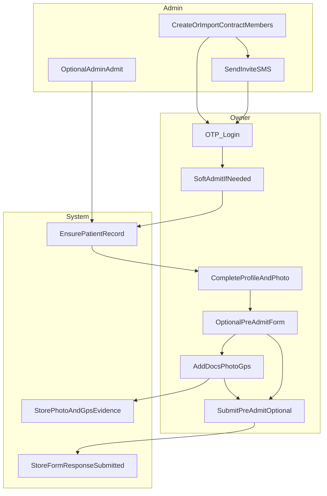

/*
 File: docs/processes/activity-diagrams/01-register-to-preadmit.md
 Description: از import قرارداد تا OTP و تکمیل اختیاری پیش‌پذیرش
 Parent Dependencies: use-cases/01-owner, use-cases/03-admin
*/

> **مسیر:** [مستندات — ایندکس](../../README.md) › فرایندها › دیاگرام ثبت تا پیش‌پذیرش

# فرایند v1: ثبت در سیستم/قرارداد تا تکمیل پیش‌پذیرش

## هدف

از ثبت بیمار در قرارداد تا ورود OTP، تکمیل هویت/عکس، و در صورت تمایل پرسشنامه/مدارک/GPS.

## نقطه شروع / پایان

- **شروع:** ایجاد/ایمپورت عضو قرارداد (معرفی به بیمارستان با نام تنظیمات کلینیک)
- **پایان:** پروفایل/عکس کامل؛ پیش‌پذیرش submitted اختیاری (`intakeCompleted`) و شواهد عکس/GPS در صورت ثبت

## نقش‌های درگیر

ادمین کلینیک، سلامتجو، سیستم (پلتفرم بعداً شواهد را می‌بیند)

## یوزکیس‌های مرتبط

[UC-ADM-04](../use-cases/03-admin.md)، [UC-ADM-06](../use-cases/03-admin.md)، [UC-ADM-08](../use-cases/03-admin.md)، [UC-OWN-01](../use-cases/01-owner.md)–[UC-OWN-10](../use-cases/01-owner.md)

## دیاگرام فعالیت

## خارج از این فرایند (فاز بعد)

صف اتاق، نوبت، ایستگاه، QR پذیرش عملیاتی، اعلام حضور.
