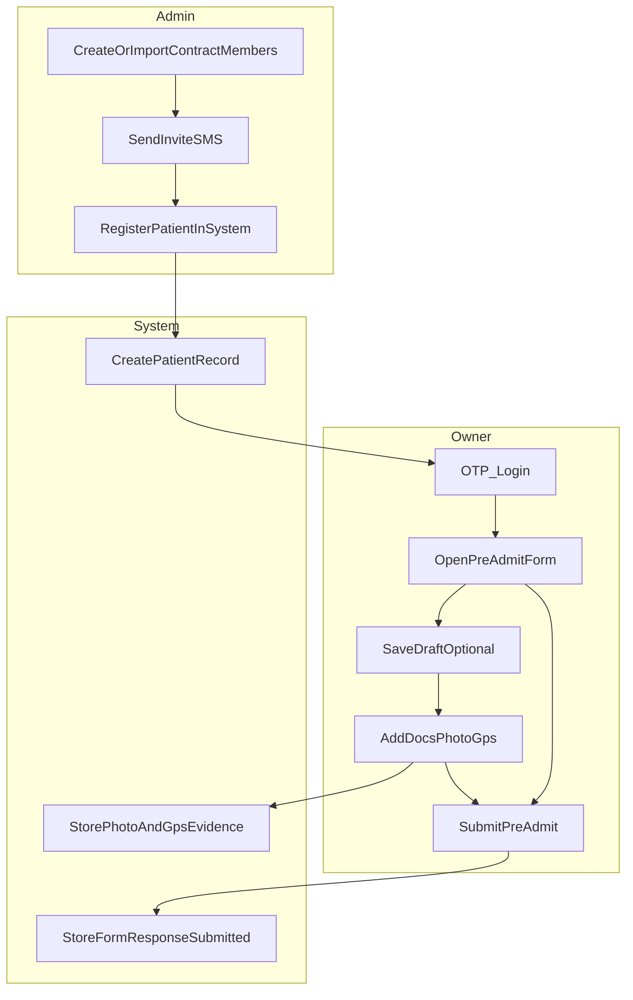

# فرایند v1: ثبت در سیستم/قرارداد تا تکمیل پیش‌پذیرش

## هدف

از ثبت بیمار در قرارداد و سیستم تا تکمیل پرسشنامه، مدارک، عکس و GPS توسط سلامتجو.

## نقطه شروع / پایان

- **شروع:** ایجاد/ایمپورت عضو قرارداد و ثبت بیمار در سیستم توسط ادمین
- **پایان:** پیش‌پذیرش submitted (`intakeCompleted`) و شواهد عکس/GPS در صورت ثبت

## نقش‌های درگیر

ادمین کلینیک، سلامتجو، سیستم (پلتفرم بعداً شواهد را می‌بیند)

## یوزکیس‌های مرتبط

[UC-ADM-04](../use-cases/03-admin.md)، [UC-ADM-06](../use-cases/03-admin.md)، [UC-ADM-08](../use-cases/03-admin.md)، [UC-OWN-01](../use-cases/01-owner.md)–[UC-OWN-10](../use-cases/01-owner.md)

## دیاگرام فعالیت

## خارج از این فرایند (فاز بعد)

صف اتاق، نوبت، ایستگاه، QR پذیرش عملیاتی، اعلام حضور.
