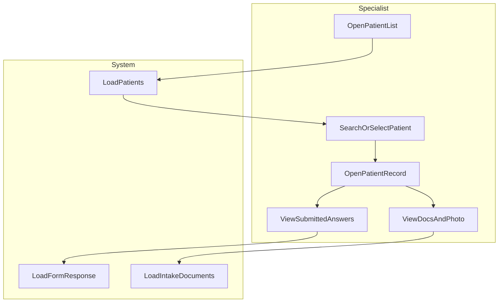

# فرایند v1: پزشک مرور پیش‌پذیرش

## هدف

پزشک بیمار ثبت‌شده را در فهرست پیدا کند و اطلاعات پیش‌پذیرش را ببیند.

## نقطه شروع / پایان

- **شروع:** بیمار در سیستم ثبت شده؛ ترجیحاً پیش‌پذیرش تکمیل شده
- **پایان:** پزشک پاسخ‌ها، مدارک و عکس را مرور کرده است

## نقش‌های درگیر

پزشک، سیستم؛ سلامتجو قبلاً داده را تولید کرده

## یوزکیس‌های مرتبط

[UC-SPC-01](../use-cases/02-specialist.md)–[UC-SPC-06](../use-cases/02-specialist.md)

## دیاگرام فعالیت

## خارج از این فرایند (فاز بعد)

فراخوان صف، اتمام ایستگاه، ثبت نسخه در جریان صف‌محور.
