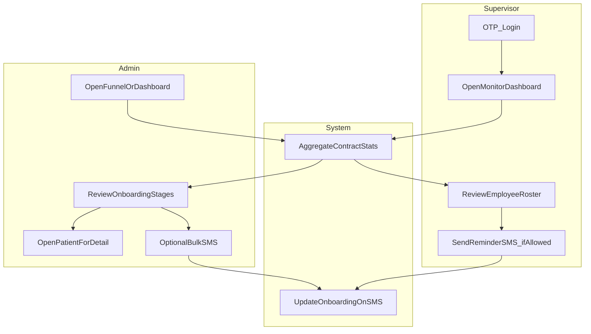

# فرایند v1: مانیتور ادمین کلینیک و ناظر سازمان

## هدف

ادمین بیمارستان و نماینده شرکت کلیات ثبت، دعوت و پیشرفت پیش‌پذیرش را بدون ورود به صف/نوبت مانیتور کنند.

## نقطه شروع / پایان

- **شروع:** قرارداد و اعضا وجود دارند
- **پایان:** وضعیت کلیات مشاهده شده؛ در صورت نیاز SMS یادآوری ارسال شده است

## نقش‌های درگیر

ادمین کلینیک، ناظر سازمان، سیستم

## یوزکیس‌های مرتبط

[UC-ADM-12](../use-cases/03-admin.md)، [UC-ADM-13](../use-cases/03-admin.md)، [UC-SUP-02](../use-cases/04-supervisor.md)–[UC-SUP-04](../use-cases/04-supervisor.md)

## دیاگرام فعالیت

## خارج از این فرایند (فاز بعد)

زمان‌بندی سقفی نوبت روزانه، صف اتاق، پذیرش عملیاتی روز مراجعه.
