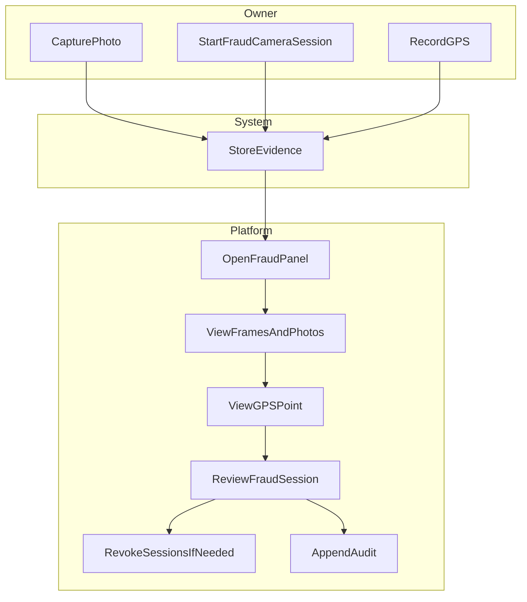

# فرایند v1: دسترسی پلتفرم به GPS و عکس‌ها

## هدف

ادمین کل شواهد عکس و GPS پیش‌پذیرش را ببیند، بازبینی کند و در صورت نیاز نشست را قطع کند.

## نقطه شروع / پایان

- **شروع:** سلامتجو عکس و/یا GPS را هنگام پیش‌پذیرش ثبت کرده است
- **پایان:** بازبینی ثبت شده و/یا نشست قطع شده است

## نقش‌های درگیر

سلامتجو (تولید شواهد)، ادمین کل، سیستم

## یوزکیس‌های مرتبط

[UC-OWN-05](../use-cases/01-owner.md)، [UC-OWN-09](../use-cases/01-owner.md)، [UC-OWN-10](../use-cases/01-owner.md)، [UC-PLT-07](../use-cases/05-platform.md)–[UC-PLT-10](../use-cases/05-platform.md)

## دیاگرام فعالیت

## کنترل کامل پلتفرم

علاوه بر شواهد، پلتفرم کاربران، تنظیمات، ممیزی و سلامت فنی را طبق [05-platform.md](../use-cases/05-platform.md) کنترل می‌کند.
