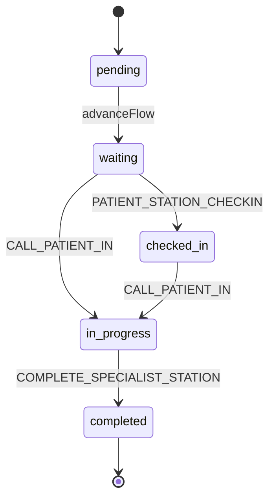
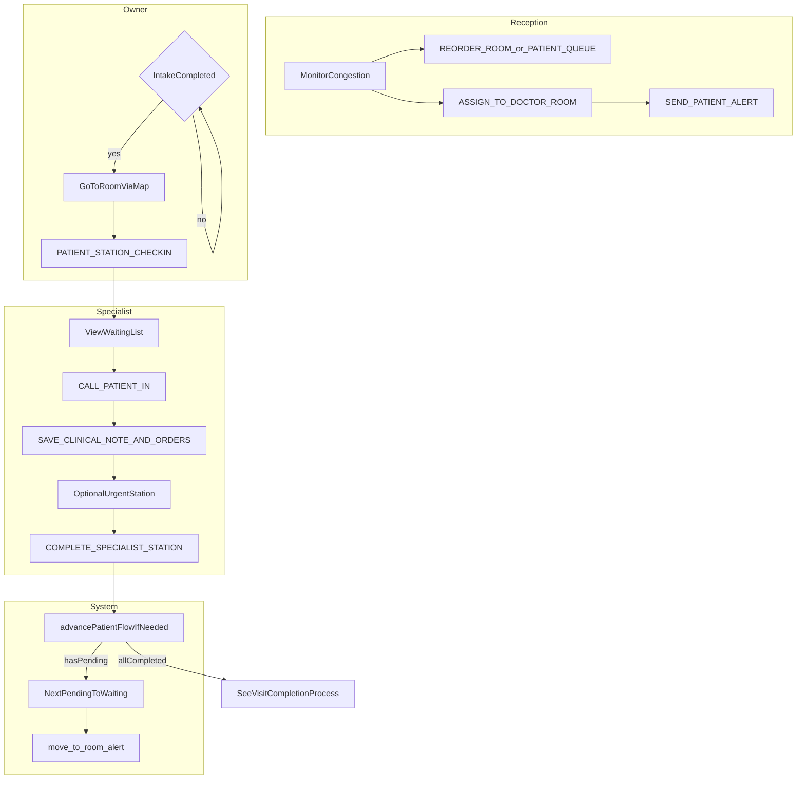

# فرایند: صف، اعلام حضور و ویزیت تخصصی

## هدف

از آمادگی ایستگاه تا اتمام ویزیت پزشک و پیشبرد خودکار مسیر.

## نقطه شروع / پایان

- **شروع:** ایستگاه در `waiting` و (ترجیحاً) `intakeCompleted`
- **پایان:** ایستگاه متخصص `completed` و فراخوانی `advancePatientFlowIfNeeded`

## نقش‌های درگیر

سلامتجو، پذیرش، پزشک، سیستم

## یوزکیس‌های مرتبط

[UC-OWN-11](../use-cases/01-owner.md)، [UC-RCP-05](../use-cases/03-reception.md)–[UC-RCP-08](../use-cases/03-reception.md)، [UC-SPC-02](../use-cases/04-specialist.md)–[UC-SPC-06](../use-cases/04-specialist.md)

## چرخه وضعیت ایستگاه

## دیاگرام فعالیت بین‌نقشی

## قواعد کلیدی

- بدون `intakeCompleted` چک‌این ایستگاه رد می‌شود؛ ارجاع به مطب ممکن است بیمار را در صف بگذارد.
- فراخوان می‌تواند از `waiting` یا `checked_in` به `in_progress` برود.
- پس از `COMPLETE_SPECIALIST_STATION` سیستم یا ایستگاه بعدی را فعال می‌کند یا فرایند اتمام مراجعه را آغاز می‌کند.
