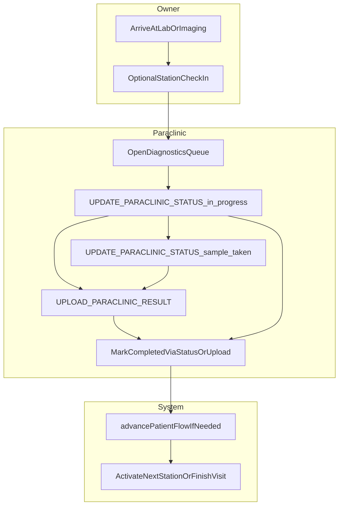

# فرایند: چرخه پاراکلینیک

## هدف

انجام خدمت تشخیصی از صف تا ثبت نتیجه و تکمیل ایستگاه.

## نقطه شروع / پایان

- **شروع:** ایستگاه پاراکلینیک در `waiting` (پس از advance یا ارجاع)
- **پایان:** ایستگاه `completed` و پیشبرد مسیر توسط سیستم

## نقش‌های درگیر

سلامتجو (حضور)، کارشناس پاراکلینیک، سیستم؛ در صورت نیاز پذیرش برای صف

## یوزکیس‌های مرتبط

[UC-OWN-11](../use-cases/01-owner.md)، [UC-PRC-01](../use-cases/05-paraclinic.md)–[UC-PRC-03](../use-cases/05-paraclinic.md)

## وضعیت‌های اختصاصی

`waiting` → `checked_in` (اختیاری) → `in_progress` → `sample_taken` (اختیاری) → `completed`

## دیاگرام فعالیت

## قواعد

- آپلود نتیجه می‌تواند هم‌زمان ایستگاه را تکمیل کند.
- اتاق‌های با `category = paraclinic` در این فرایند قرار می‌گیرند (مثلاً LAB، ECG، RADIO).
