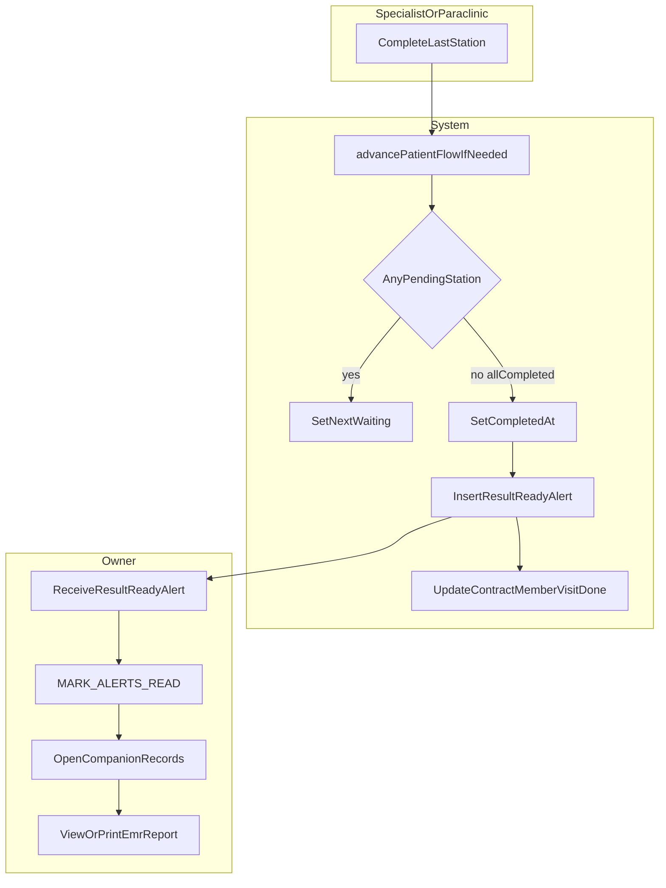

# فرایند: اتمام مراجعه و گزارش یک‌روزه

## هدف

بستن کامل مسیر درمانی روز و آماده‌سازی گزارش/اعلان نتیجه برای سلامتجو (و بازتاب به قرارداد در صورت پیوند).

## نقطه شروع / پایان

- **شروع:** آخرین ایستگاه فعال به `completed` می‌رسد
- **پایان:** `patient.completedAt` ثبت شده؛ اعلان `result_ready`؛ گزارش قابل مشاهده/چاپ؛ در قرارداد `visit_done`

## نقش‌های درگیر

پزشک یا پاراکلینیک (اتمام ایستگاه آخر)، سیستم، سلامتجو؛ اختیاری پذیرش

## یوزکیس‌های مرتبط

[UC-SPC-06](../use-cases/04-specialist.md)، [UC-PRC-02](../use-cases/05-paraclinic.md)، [UC-OWN-12](../use-cases/01-owner.md)، [UC-OWN-13](../use-cases/01-owner.md)

## دیاگرام فعالیت

## خروجی‌ها

| خروجی | شرح |
|-------|-----|
| `completedAt` | زمان اتمام مراجعه |
| اعلان `result_ready` | پیام آماده‌بودن PDF/گزارش |
| `appointmentStatus = visit_done` | اگر عضو قرارداد لینک شده باشد |
| گزارش یک‌روزه | UI چاپ/مشاهده برای سلامتجو و staff |
