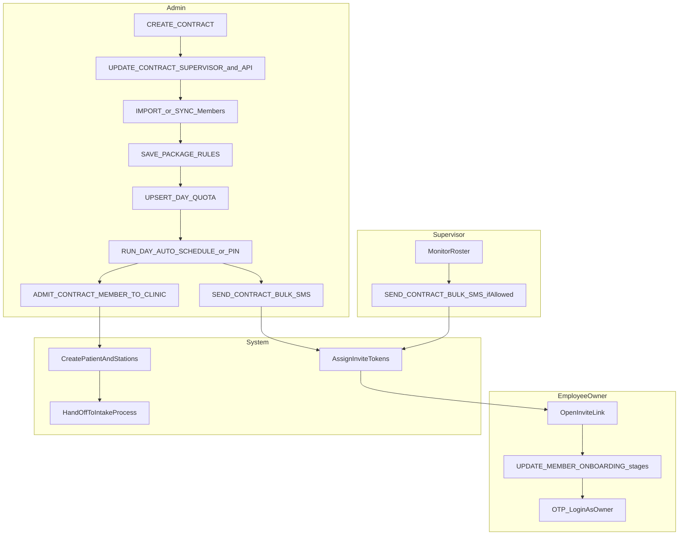

# فرایند: قیف قرارداد سازمانی تا پذیرش روز مراجعه

## هدف

از تعریف قرارداد تا دعوت، زمان‌بندی سقفی، و پذیرش عضو در کلینیک در روز چکاپ.

## نقطه شروع / پایان

- **شروع:** `CREATE_CONTRACT` توسط ادمین
- **پایان:** بیمار کلینیک ساخته‌شده و ورود به فرایند [پذیرش تا پیش‌پذیرش](01-admission-to-intake.md)

## نقش‌های درگیر

ادمین کلینیک، ناظر سازمان، عضو/سلامتجو (لینک دعوت)، سیستم

## یوزکیس‌های مرتبط

[UC-ADM-12](../use-cases/06-admin.md)–[UC-ADM-26](../use-cases/06-admin.md)، [UC-SUP-04](../use-cases/08-supervisor.md)، [UC-OWN-01](../use-cases/01-owner.md)

## وضعیت‌های قیف

**Onboarding:** `not_sent` → `sms_sent` → `link_opened` → `logged_in` → `completed` | `abandoned`

**نوبت:** `unscheduled` → `pinned` | `auto_scheduled` → `checked_in` → `visit_done`

## دیاگرام فعالیت

## قواعد

- ناظر فقط `SEND_CONTRACT_BULK_SMS` را از میان contract-actions اجرا می‌کند.
- `UPDATE_MEMBER_ONBOARDING` می‌تواند از لینک دعوت (بدون نقش ادمین) هم بیاید.
- پذیرش روز مراجعه مسیر ایستگاه‌ها را از pathway/بسته عضو می‌سازد.
