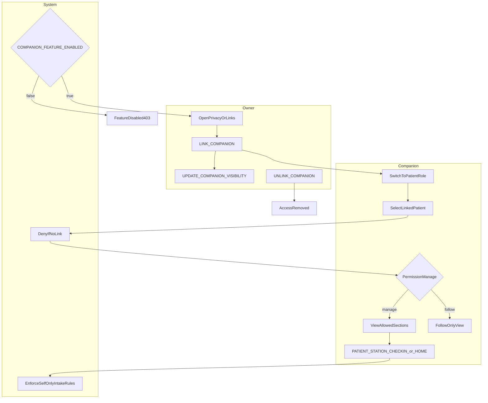

# فرایند: دسترسی همراه سلامتجو

## هدف

ایجاد، محدودسازی و استفاده از دسترسی همراه به پرونده سلامتجو تا قطع لینک.

## نقطه شروع / پایان

- **شروع:** درخواست لینک همراه توسط سلامتجو (feature روشن)
- **پایان:** همراه در محدوده `permission`/`visibility` پیگیری می‌کند، یا لینک قطع می‌شود

## نقش‌های درگیر

سلامتجو (`owner`)، همراه (`patient`)، سیستم

## یوزکیس‌های مرتبط

[UC-OWN-17](../use-cases/01-owner.md)، [UC-CMP-01](../use-cases/02-companion.md)–[UC-CMP-10](../use-cases/02-companion.md)

## مدل اجازه

| سطح | معنی |
|-----|------|
| `manage` | پیگیری + چک‌این/خانه (نه فرم/عکس/مدارک) |
| `follow` | فقط مشاهده در محدوده visibility |
| visibility flags | journey، results، diagnoses، medications، allergies، familyHistory، reports |

## دیاگرام فعالیت

## قواعد سخت

- پرسشنامه، عکس و مدارک intake فقط با رابطه `self`.
- نقش `owner` روی لینک غیر-self کار نمی‌کند؛ باید نقش همراه فعال شود.
- با feature خاموش، تمام `LINK/UNLINK/UPDATE_COMPANION_VISIBILITY` → 403.
