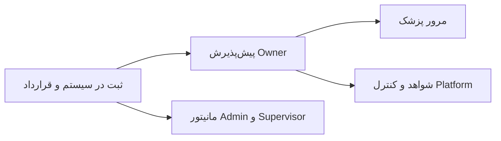

/*
 File: docs/shared/platform-strategic-plan.md
 Description: برنامه استراتژیک پلتفرم پیش‌پذیرش — تجمیع فیچر/فرایند فعلی، آیندهٔ مستند، و پیشنهادات محصولی
 Parent Dependencies: docs/processes, docs/README.md, .cursor/rules/project-context.mdc
*/

> **مسیر:** [مستندات — ایندکس](../README.md) › [Shared](README.md) › برنامه استراتژیک پلتفرم  
> **پدر:** [Shared](README.md)  
> **نسخهٔ سند:** ۱۴۰۵/۰۸/۳۰ · دامنهٔ محصول: **نفس / Nabz** (پیش‌پذیرش کلینیکی + قیف سازمانی)

# برنامه استراتژیک پلتفرم پیش‌پذیرش

این فایل **نقطهٔ تجمیع** است: آنچه امروز در v1 زنده است، آنچه در `processes/future` برای فازهای بعد نگه داشته شده، و پیشنهادهای محصولی برای همین تیپ سیستم (pre-admit + corporate funnel + evidence). جزئیات اجرایی UC در فایل‌های نقش می‌ماند؛ اینجا برای تصمیم‌گیری و اولویت‌بندی نوشته شده است.

---

## ۱. تز محصول (یک جمله)

**نفس** قبل از روز مراجعه، هویت و ریسک بالینی را از مسیر **قرارداد سازمانی → OTP → پیش‌پذیرش مشروط → شواهد ضدتقلب (عکس/GPS)** جمع می‌کند تا پزشک و ادمین کلینیک با پروندهٔ آماده کار کنند، و ادمین کل بتواند کیفیت و تقلب را در مقیاس پلتفرم ببیند — بدون اینکه هنوز وارد صف اتاق و نوبت عملیاتی شود.

### تمایز نسبت به HIS / نوبت‌دهی کلاسیک

| لایه | HIS سنتی | نفس v1 |
|------|----------|--------|
| نقطهٔ شروع | پذیرش روز مراجعه | دعوت و تکمیل از راه دور (قبل از حضور) |
| ارزش برای پزشک | ثبت پس از ویزیت | خواندن intake قبل از ورود بیمار به اتاق |
| ارزش برای سازمان طرف قرارداد | گزارش بعد از خدمت | قیف onboarding + SMS قالبی + مانیتور ناظر |
| اعتماد به حضور واقعی | حضوری / کارت | GPS + فریم دوربین + خزانهٔ Platform |

---

## ۲. مرز نسخهٔ ۱ (as-is)

### ۲.۱ بازیگران زنده

| نقش | شناسه | مسئولیت اصلی v1 |
|-----|--------|------------------|
| سلامتجو | `owner` | OTP، پیش‌پذیرش، مدارک، عکس، GPS، پروفایل |
| پزشک متخصص | `specialist` | فهرست/جستجو و مشاهدهٔ intake + مدارک |
| ادمین کلینیک | `admin` | قرارداد، اعضا، مسیر سلامتی، فرم‌ساز، قیف، کاربران کلینیک |
| ناظر سازمان | `supervisor` | رستر و قیف قرارداد خود + SMS یادآوری |
| ادمین کل | `platform` | تنظیمات، کاربران، شواهد fraud/GPS، خزانه، ممیزی؛ **Platform ⊇ Admin** روی دامنهٔ کلینیک جاری |

خارج از v1: پذیرش عملیاتی، پاراکلینیک، همراه — رجوع بخش ۴.

### ۲.۲ جریان خلاصهٔ فرایندهای v1

| فرایند | سند فعالیت | خروجی کسب‌وکار |
|--------|------------|----------------|
| ثبت تا تکمیل پیش‌پذیرش | [`01-register-to-preadmit`](../processes/activity-diagrams/01-register-to-preadmit.md) | عضو قرارداد → soft-admit → draft/submit فرم + مدارک |
| پزشک مرور پیش‌پذیرش | [`02-doctor-reviews-intake`](../processes/activity-diagrams/02-doctor-reviews-intake.md) | chart فقط‌خواندنی intake |
| مانیتور ادمین و ناظر | [`03-admin-supervisor-monitor`](../processes/activity-diagrams/03-admin-supervisor-monitor.md) | قیف onboarding، رستر، SMS |
| شواهد GPS/عکس پلتفرم | [`04-platform-fraud-evidence`](../processes/activity-diagrams/04-platform-fraud-evidence.md) | بازبینی ضدتقلب + خزانه فایل |

منبع UCها: [`docs/processes/README.md`](../processes/README.md).

### ۲.۳ کاتالوگ فیچر فعلی به‌تفکیک نقش

#### سلامتجو (`UC-OWN-*`)

| شناسه | فیچر |
|-------|------|
| UC-OWN-01 | ورود OTP + انتخاب هویت چندکدملی؛ soft-admit از عضو قرارداد |
| UC-OWN-02 | خانه مینیمال: فاصله تا بیمارستان، مسیر درمان، بنر معرفی، ورود نشست‌محور به پیش‌پذیرش |
| UC-OWN-03 | draft پرسشنامه در سطح بخش + hydrate از سرور |
| UC-OWN-04 | submit نهایی پرسشنامه |
| UC-OWN-05 | عکس پرونده (پرتره اجباری در پیش‌پذیرش بدون پرتره قبلی) |
| UC-OWN-06…08 | گروه مدارک + فایل + حذف |
| UC-OWN-09 | نشست ضدتقلب دوربین (فریم مبهم کلاینت → unwrap سرور) |
| UC-OWN-10 | GPS شواهد (دکمه فاصله / باز شدن نقشه؛ watch موبایل ≥۱۰۰م) |
| UC-OWN-11 | قطع نشست خود |
| UC-OWN-12 | آدرس سکونت در دموگرافیک |
| UC-OWN-13 | ویرایش پروفایل پرونده + سوابق |

#### پزشک (`UC-SPC-*`)

| شناسه | فیچر |
|-------|------|
| UC-SPC-01…03 | فهرست، جستجو، استعلام کدملی |
| UC-SPC-04…06 | باز کردن پرونده، پاسخ‌های پیش‌پذیرش، مدارک و عکس |

#### ادمین کلینیک (`UC-ADM-*`)

| شناسه | فیچر |
|-------|------|
| UC-ADM-01…03 | قرارداد سازمانی، ناظر، API/همگام اعضا |
| UC-ADM-04 / 04b | ورود / ویرایش / حذف عضو |
| UC-ADM-05 / 05b | مسیرهای سلامتی قرارداد + کتابخانه مرکزی مسیر سلامتی |
| UC-ADM-06 | پیامک دعوت فردی/گروهی (فقط قالب کاوه‌نگار) |
| UC-ADM-07 | به‌روزرسانی قیف onboarding |
| UC-ADM-08 | ثبت بیمار عضو در سیستم (Admit اختیاری؛ soft-admit هم هست) |
| UC-ADM-09…11 | فرم‌ساز: ایجاد/ویرایش، انتشار، مرتب‌سازی |
| UC-ADM-18 | import/export بسته پرسشنامه (JSON/Excel) |
| UC-ADM-19 | کاتالوگ ماتریس سرطان (seed + مخاطب) |
| UC-ADM-12…13 | مانیتور کلیات + وضعیت پیش‌پذیرش |
| UC-ADM-20 | تغییر موبایل بیمار |
| UC-ADM-14 | ریست دمو از مسیر سرور/پلتفرم (نه mock ادمین) |
| UC-ADM-15…17 | کاربران کلینیک |
| UC-ADM-21 | نام، لوکیشن و شماره پشتیبانی پیش‌پذیرش |
| UC-ADM-22 | ویرایش مشخصات پایه قرارداد |

#### ناظر (`UC-SUP-*`)

| شناسه | فیچر |
|-------|------|
| UC-SUP-01…05 | OTP، داشبورد پایش، رستر، SMS گروهی یادآوری، خروج |

#### ادمین کل (`UC-PLT-*`)

| شناسه | فیچر |
|-------|------|
| UC-PLT-01…03 | وضعیت کلینیک، تنظیمات پایه، OSM |
| UC-PLT-04…06 | کاربران پلتفرم، فعال/غیرفعال، ریست دسترسی |
| UC-PLT-07…09 | بازبینی fraud (تک‌نشست/چندنشست) + GPS |
| UC-PLT-10…13 | قطع نشست، ممیزی، سلامت فنی، ریست فکتوری (غیر-prod) |
| UC-PLT-14 | خزانه فایل سلسله‌مراتبی شواهد (soft/hard delete) |

### ۲.۴ قابلیت‌های افقی (زیرساخت محصولی v1)

- **هویت واحد `Person`:** نام/کدملی/موبایل؛ موبایل تکراری برای چند Person مجاز.
- **Auth:** OTP قالبی کاوه‌نگار؛ `Auth__FixedOtp` فقط dev/demo؛ نشست opaque.
- **فرم پیش‌پذیرش مشروط:** مخاطب جنسیت/سن/تاهل + `visibilityRules`؛ seed سرطان مرد/زن؛ بخش خالی از استپر حذف می‌شود — [`شرط-نمایش-و-مخاطب-پرسشنامه.md`](../شرط-نمایش-و-مخاطب-پرسشنامه.md).
- **ماتریس نقش:** Platform ⊇ Admin روی دامنهٔ کلینیک؛ سوئیچ UI ≠ تعویض JWT.
- **ذخیره‌سازی:** آپلود پایدار در `persist/uploads`؛ فریم تقلب فقط Platform.
- **صفحه‌بندی استاندارد** و hydrate تنبل تامنیل تقلب.
- **CORS / edge:** triage اجباری قبل از پچ CORS؛ origins زنده my/news/api.
- **دیپلوی:** `server/publish.bat` + دروازهٔ `pre-publish-tests` (Unit BE/FE + API smoke روی MSSQL).
- **ویترین news:** اسکلت دیپلوی آماده؛ فرانت جدا هنوز نیست.

### ۲.۵ آنچه صریحاً خارج از v1 است

صف اتاق، نوبت کلینیک، زمان مراجعه، ایستگاه مسیر، چک‌این، فراخوان پزشک، ویزیت صف‌محور، پاراکلینیک عملیاتی، پذیرش روز مراجعه، همراه سلامتجو، سقف نوبت روزانهٔ قرارداد (فراتر از مانیتور فعلی).

---

## ۳. نقشهٔ راه مستندشده (future — از قبل در ریپو)

منبع: [`docs/processes/future/README.md`](../processes/future/README.md).

### ۳.۱ نقش‌ها و UCهای فاز بعد

| نقش | پیشوند | محور |
|-----|--------|------|
| همراه | `UC-CMP-*` | لینک دسترسی، پیگیری پرونده مجاز، اعلام حضور به‌جای بیمار، نقشه مسیر |
| پذیرش | `UC-RCP-*` | جستجو، پذیرش+QR، جریان زنده، صف اتاق، ایستگاه‌ها، اعلان، هدایت از اتاق شلوغ |
| پاراکلینیک | `UC-PRC-*` | صف تشخیصی، وضعیت نمونه، آپلود نتیجه، پرونده |

### ۳.۲ فرایندهای فاز بعد

| فرایند | محتوا |
|--------|--------|
| صف / حضور / ویزیت | چک‌این ایستگاه، فراخوان، یادداشت بالینی، پیشبرد خودکار مسیر |
| چرخه پاراکلینیک | سفارش → نمونه → نتیجه → برگشت به مسیر |
| اتمام مراجعه و گزارش یک‌روزه | بستن visit + خروجی گزارش |
| دسترسی همراه | مدل اجازه محدود، قطع لینک |
| قیف قرارداد تا روز مراجعه | سقف روزانه، auto-schedule/pin، چک‌این روز خدمت |

### ۳.۳ شکاف قیف سازمانی (نیمه‌پیاده در v1)

در v1: قرارداد، اعضا، مسیر سلامتی، SMS، مراحل onboarding، مانیتور.  
در future: `UPSERT_DAY_QUOTA`، زمان‌بندی سقفی، `checked_in` روز مراجعه، ساخت ایستگاه از pathway — این‌ها پل طبیعی از «پیش‌پذیرش از راه دور» به «عملیات روز خدمت» هستند.

---

## ۴. پیشنهادهای استراتژیک (خارج از future فعلی)

پیشنهادها برای **همین تیپ پلتفرم** (B2B2C پیش‌پذیرش + ضدتقلب + قرارداد سازمانی) هستند؛ هنوز UC رسمی ندارند مگر خلاف آن گفته شود. اولویت‌ها نسبی‌اند و باید با مالک محصول نهایی شوند.

### ۴.۱ لایهٔ بالینی و ارزش پزشک (اعتماد و سرعت)

| کد | پیشنهاد | چرا برای این تیپ سیستم |
|----|---------|-------------------------|
| S-CLIN-01 | **خلاصهٔ یک‌صفحه‌ای ریسک برای پزشک** (پرچم‌های قرمز از پاسخ‌های سرطان + مدارک ناقص) قبل از باز کردن کل فرم | پزشک در دقیقهٔ اول تصمیم می‌گیرد چه چیزی را عمیق بخواند |
| S-CLIN-02 | **نسخه‌گذاری پاسخ submit** + diff بعد از ویرایش مجاز | ممیزی بالینی و اختلاف «آنچه پزشک دید» vs «آنچه بعداً عوض شد» |
| S-CLIN-03 | **امضای دیجیتال / «دیده‌شد» پزشک** روی intake (timestamp + userId) | بستن حلقهٔ مسئولیت قبل از ویزیت؛ بدون claim تشخیصی |
| S-CLIN-04 | **قالب‌های فرم تخصصی جدا از سرطان** (قلب، ارتوپدی، اطفال با سن مناسب) با همان موتور مخاطب | موتور visibility دارایی اصلی است؛ کاتالوگ قابل فروش به‌ازای تخصص |
| S-CLIN-05 | **خروجی PDF/چاپ پرونده پیش‌پذیرش** برای پروندهٔ کاغذی/بایگانی | پذیرش کلینیک‌های نیمه‌دیجیتال |

**قید:** هیچ پیشنهاد بالینی نباید به‌عنوان تشخیص یا توصیهٔ درمانی مطرح شود؛ فقط سازمان‌دهی دادهٔ خوداظهاری و شواهد.

### ۴.۲ لایهٔ سازمانی و قیف B2B (تبدیل دعوت به تکمیل)

| کد | پیشنهاد | چرا |
|----|---------|-----|
| S-B2B-01 | **SLA قیف و هشدار ریزش** (مثلاً `sms_sent` بدون `logged_in` پس از N روز) برای Admin و Supervisor | قیف بدون اقدام خودکار فقط داشبورد تزئینی است |
| S-B2B-02 | **پورتال ناظر فقط‌خواندنی + KPI قرارداد** (نرخ تکمیل پیش‌پذیرش، نرخ GPS معتبر، نرخ عکس) | ارزش خرید برای سازمان کارفرما |
| S-B2B-03 | **همگام‌سازی HR واقعی** (CSV امن / API با webhook) با reconcile کدملی | import دستی مقیاس نمی‌گیرد |
| S-B2B-04 | **چندکلینیک / چندشعبه در یک قرارداد** با سهمیهٔ شعبه | سازمان‌های ملی چندمرکزی |
| S-B2B-05 | **بستهٔ قیمت‌گذاری پلتفرم** بر اساس عضو فعال / فرم submit / حجم شواهد — جدا از صورتحساب بالینی | مدل درآمد SaaS شفاف |

### ۴.۳ لایهٔ ضدتقلب و اعتماد (دارایی تمایزدهندهٔ فعلی)

| کد | پیشنهاد | چرا |
|----|---------|-----|
| S-EVD-01 | **امتیاز اعتماد ترکیبی** (GPS پایدار + فریم + تطابق پرتره سطح پایین بدون ادعای بیومتریک قانونی) برای اولویت بازبینی Platform | صف بازبینی دستی مقیاس‌پذیر نیست |
| S-EVD-02 | **سیاست نگهداری و حذف شواهد** (retention) قابل تنظیم per-tenant + گزارش ممیزی حذف | الزام حریم خصوصی و قرارداد سازمانی |
| S-EVD-03 | **ژئوفنس اختیاری روز مراجعه** (فقط وقتی نوبت/حضور فعال شد) جدا از GPS پیش‌پذیرش | جلوگیری از قاطی شدن «اثبات مسیر خانه» با «حضور در کلینیک» |
| S-EVD-04 | **تشخیص چنددستگاهی مشکوک** (نشست‌های هم‌زمان Owner با الگوی غیرعادی) | تکمیل UCهای revoke فعلی |

### ۴.۴ لایهٔ عملیات روز خدمت (پل به future صف)

ترتیب پیشنهادی بعد از تثبیت v1 — هم‌راستا با future ولی با برش MVP:

1. **سقف روزانه + پین نوبت قرارداد** (از دیاگرام قیف future) بدون صف اتاق کامل  
2. **اعلام حضور ساده (چک‌این)** بدون reorder صف  
3. **فراخوان پزشک تک‌اتاق**  
4. سپس صف چنداتاق، پاراکلینیک، همراه  

این برش از «ساخت HIS کوچک» جلوگیری می‌کند و ارزش پیش‌پذیرش را به روز خدمت وصل می‌کند.

### ۴.۵ لایهٔ محصول دیجیتال و کانال‌ها

| کد | پیشنهاد | چرا |
|----|---------|-----|
| S-CH-01 | **ویترین news واقعی** (محتوای اعتمادساز + لینک ورود my) روی اسکلت فعلی `server/news` | تبدیل دامنهٔ عمومی به قیف جذب کلینیک/سازمان |
| S-CH-02 | **لینک دعوت عمیق با token یک‌بارمصرف** که مرحلهٔ onboarding را از SMS تا OTP بدون ابهام طی کند | کاهش ریزش `sms_sent → logged_in` |
| S-CH-03 | **PWA / نصب موبایل** برای Owner (عکس و GPS روی موبایل حیاتی‌اند) | UX پیش‌پذیرش موبایل‌اول |
| S-CH-04 | **کیوسک legacy را صریحاً deprecate یا به API وصل کن** | امروز فقط mock باقی مانده؛ بدهی اعتماد به دمو |

### ۴.۶ لایهٔ داده، یکپارچگی و حاکمیت

| کد | پیشنهاد | چرا |
|----|---------|-----|
| S-DAT-01 | **Export بستهٔ قرارداد** (اعضا + وضعیت قیف + وضعیت پیش‌پذیرش) برای سازمان | بسته شدن فروش B2B |
| S-DAT-02 | **رویدادنامهٔ دامنه** (Domain events) برای onboarding/submit/fraud جهت BI بعدی | بدون قفل شدن به یک ابزار گزارش |
| S-DAT-03 | **چندزبانه / RTL-ready برای بازار دوم** فقط پس از product-market fit ایران | گسترش بدون شکستن فارسی اول |
| S-DAT-04 | **هم‌ترازی با استانداردهای تبادل سلامت** (حداقل HL7 FHIR Patient/QuestionnaireResponse در لایهٔ export اختیاری) | دروازهٔ اتصال به HIS بدون ادعای جایگزینی |

### ۴.۷ لایهٔ انطباق، ایمنی و روایت بیرونی

| کد | پیشنهاد | چرا |
|----|---------|-----|
| S-REG-01 | **سند حریم خصوصی و رضایت صریح Owner** برای GPS و دوربین قبل از StartFraud | شواهد بدون رضایت شفاف ریسک حقوقی است |
| S-REG-02 | **جداسازی نقش «بازرس قرارداد» از «ادمین کلینیک»** در UI گزارش‌ها | سازمان‌ها نمی‌خواهند دادهٔ خام کلینیک را با ادمین مخلوط ببینند |
| S-REG-03 | **روایت واحد برای سرمایه‌گذار/وزارت/پزشک:** پیش‌پذیرش = کاهش زمان مردهٔ ویزیت + شفافیت قیف سازمانی + کنترل کیفیت حضور — بدون ادعای outcome بالینی بدون دادهٔ معتبر | جلوگیری از version drift روایت |

---

## ۵. افق زمانی پیشنهادی (برنامهٔ فازبندی)

تاریخ‌ها نسبی‌اند؛ با ظرفیت تیم و فروش تنظیم شوند.

| فاز | تمرکز | ورودی از as-is / future / پیشنهاد |
|-----|--------|-----------------------------------|
| **V1 Stabilize** | بستن بدهی UX/عملیاتی پیش‌پذیرش، تست پیش‌انتشار سبز پایدار، deprecate مسیرهای mock گمراه‌کننده | وضعیت فعلی + S-CH-04 |
| **V1.1 Trust & Funnel** | KPI ریزش قیف، هشدار ناظر، retention شواهد، رضایت GPS/دوربین، خلاصهٔ ریسک پزشک | S-B2B-01/02، S-EVD-02، S-REG-01، S-CLIN-01 |
| **V2 Day-of Bridge** | سقف نوبت روزانه، پین، چک‌این ساده، فراخوان تک‌اتاق | future قیف + صف بریده‌شده |
| **V2.1 Companion Lite** | لینک همراه فقط‌خواندنی + اعلان | `UC-CMP` زیرمجموعه |
| **V3 Ops Full** | صف چنداتاق، پاراکلینیک، گزارش یک‌روزه | future کامل reception/paraclinic |
| **Platform Growth** | ویترین news، قیمت‌گذاری SaaS، HR sync، FHIR export اختیاری | S-CH-01، S-B2B-03/05، S-DAT-04 |

---

## ۶. اصول غیرقابل نقض (از معماری محصول)

این‌ها تصمیم استراتژیک نیستند؛ **قفل مهندسی** هستند و هر فاز جدید باید آن‌ها را حفظ کند:

1. لایهٔ Service بدون EF/DbContext؛ فقط Repository از طریق اینترفیس.  
2. SMS فقط قالبی؛ FixedOtp فقط غیرپروداکشن.  
3. Platform ⊇ Admin روی دامنهٔ کلینیک؛ Owner/Specialist دامنهٔ شواهد نوشتنی خودشان را دارند.  
4. triage CORS قبل از پچ سیاست.  
5. هر جریان نهایی‌شده = UC + سند + تست + دروازهٔ pre-publish.  
6. دادهٔ پایدار فقط زیر `server/persist/` با bind mount.

---

## ۷. معیارهای موفقیت پیشنهادی (قابل اندازه‌گیری)

| حوزه | متریک | هدف اولیه (قابل بازنگری) |
|------|--------|---------------------------|
| قیف سازمانی | نرخ `sms_sent → logged_in` | افزایش پایدار پس از لینک عمیق |
| پیش‌پذیرش | نرخ submit کامل در ۷ روز پس از login | تعریف با دادهٔ دمو سپس پروداکشن |
| پزشک | زمان تا «اولین باز کردن intake» در روز مراجعه | کاهش نسبت به بدون سیستم |
| ضدتقلب | درصد نشست‌های نیازمند بازبینی دستی | کاهش با امتیاز اعتماد |
| پلتفرم | آپتایم API + سبز بودن pre-publish | بدون رگرسیون لایه‌بندی |

---

## ۸. نقشهٔ اسناد زنده (منبع حقیقت جزئیات)

| موضوع | سند |
|--------|-----|
| ایندکس مستندات | [`docs/README.md`](../README.md) |
| فرایند و UC نسخهٔ ۱ | [`processes/README.md`](../processes/README.md) |
| فازهای بعد | [`processes/future/README.md`](../processes/future/README.md) |
| شرط نمایش فرم | [`شرط-نمایش-و-مخاطب-پرسشنامه.md`](../شرط-نمایش-و-مخاطب-پرسشنامه.md) |
| changelog فرایندی | [`process-changelog.md`](process-changelog.md) |
| ماتریس تست پیش‌انتشار | [`pre-release-test-matrix.md`](pre-release-test-matrix.md) |
| کاتالوگ Unit | [`unit-test-scenarios.md`](unit-test-scenarios.md) |
| دیپلوی | [`server-deploy.md`](server-deploy.md) |
| overlay نام‌ها/نقش‌ها | [`.cursor/rules/project-context.mdc`](../../.cursor/rules/project-context.mdc) |

---

## ۹. وضعیت تصمیم‌های باز (صریح)

این موارد در کد/UC فعلی **قطعی نشده‌اند** و نباید در روایت بیرونی به‌عنوان تعهد اعلام شوند مگر مالک محصول قفل کند:

- [ ] اولویت فروش: تک‌کلینیک تخصصی سرطان vs چندتخصصی عمومی  
- [ ] مرز قانونی نگهداری GPS/فریم و مدت retention  
- [ ] آیا روز خدمت (صف) جزء همان محصول است یا ماژول جدا با لایسنس جدا  
- [ ] مدل قیمت: per-seat سازمان / per-submit / per-clinic  
- [ ] زمان ساخت ویترین news و محتوای اعتمادساز  
- [ ] اتصال FHIR/HIS: فقط export یا همگام دوطرفه  

---

**ناوبری:** [مستندات — ایندکس](../README.md) · [Shared](README.md) · [فرایندهای v1](../processes/README.md) · [آینده](../processes/future/README.md)
