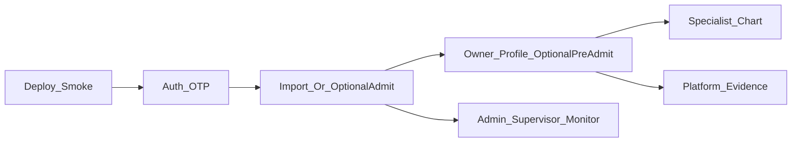

/*
 File: docs/shared/pre-release-test-matrix.md
 Description: ماتریس تست دستی قبل‌از‌انتشار برای جریان‌های v1
 Parent Dependencies: docs/processes/use-cases, docs/shared/server-deploy.md
*/

> **مسیر:** [مستندات — ایندکس](../README.md) › [Shared](README.md) › pre-release-test-matrix  
> **پدر:** [Shared](README.md)

# ماتریس تست قبل‌از‌انتشار — نسخهٔ ۱

دروازهٔ QA قبل از [`server/publish.bat`](../../server/publish.bat). هر ردیف را Pass/Fail بزنید؛ بدون Pass روی بلوک‌های بحرانی (Auth، Owner chain، Deploy smoke) انتشار نکنید.

**دامنه:** فقط نقش‌های v1 (`owner` / `specialist` / `admin` / `supervisor` / `platform`). نقش‌های [`../processes/future/`](../processes/future/README.md) خارج از این ماتریس‌اند.

**مرجع یوزکیس:** [`../processes/use-cases/00-actors-and-system.md`](../processes/use-cases/00-actors-and-system.md)

**OTP / SMS روی سرور:** [`server-deploy.md`](server-deploy.md) § ماتریس OTP

---

## نحوهٔ اجرا

| آیتم | مقدار پیشنهادی |
|------|----------------|
| Env | staging یا لوکال نزدیک به prod |
| FixedOtp | در staging مجاز؛ در smoke نهایی prod باید **خالی** باشد |
| ادمین کل | موبایل ثابت `09133752696` |
| ستون Pass/Fail | `P` / `F` / خالی |

### حساب‌ها و NID پایهٔ seed (`DEMO-ORG`)

| نقش / مورد | موبایل | کد ملی | یادداشت |
|------------|--------|--------|---------|
| ادمین کل | `09133752696` | — | Platform |
| ادمین کلینیک | `09120000001` | — | می‌بیند DEMO-ORG |
| پزشک | `09120000002` | — | Specialist |
| سلامتجو (مالک) | `09123458910` | `0012345679` | عضو قرارداد + بیمار لینک‌شده؛ هم‌شماره با علی `0012345687` |
| ناظر | `09123409876` | — | Supervisor روی DEMO-ORG |
| عضو آمادهٔ admit | `09121112233` | `0011223340` | در قرارداد |
| تست گیت بلاک | — | `0099887766` | **عضو نیست** → پیام بلاک پذیرش |

---

## ۰ — Deploy smoke

| TC-ID | UC | بازیگر / env | پیش‌شرط | گام‌ها | نتیجهٔ مورد انتظار | Pass/Fail |
|-------|-----|--------------|---------|--------|---------------------|-----------|
| TC-DEP-01 | — | ops / publish | `sync.config.bat` درست | `publish.bat` یا sync-deploy؛ باز کردن URL عمومی my | فرانت بالا می‌آید؛ درخواست‌ها به API عمومی می‌روند نه `localhost` | |
| TC-DEP-02 | — | ops / API | compose بالا | استارت API؛ لاگ migrate | `MigrateAsync` بدون خطا؛ seed کلینیک/نقش‌ها | |
| TC-DEP-03 | — | ops / persist | volume bind | آپلود فایل آزمایشی از UI | فایل زیر `server/persist/uploads` می‌ماند (نه داخل image) | |
| TC-DEP-04 | — | ops / prod | آمادهٔ انتشار عمومی | بررسی env API | `Auth__FixedOtp` خالی؛ `Kavenegar__ApiKey` + `OtpTemplate` پر | |
| TC-DEP-05 | — | ops / DebtC | پس از migrate | ردیف بدهی میدان در DB/لاگ | «verify DebtC applied» — اعمال دستی خارج از scope | |

---

## ۱ — Auth / OTP

| TC-ID | UC | بازیگر / env | پیش‌شرط | گام‌ها | نتیجهٔ مورد انتظار | Pass/Fail |
|-------|-----|--------------|---------|--------|---------------------|-----------|
| TC-AUTH-01 | UC-OWN-01 | owner / FixedOtp | موبایل در سیستم ثبت | ورود → شماره → ارسال کد → وارد کردن کد ثابت | ورود به داشبورد؛ بدون فراخوانی SMS | |
| TC-AUTH-02 | UC-OWN-01 | owner | شماره ثبت‌نشده | ارسال کد با موبایل ناشناس | پیام خطا؛ مرحلهٔ کد باز نمی‌شود | |
| TC-AUTH-03 | UC-OWN-01 | owner | کد صادر شده | کد غلط ۵ رقمی | خطا؛ نشست ساخته نمی‌شود | |
| TC-AUTH-04 | UC-OWN-01 | owner | کد منقضی / انقضا صفر | صبر تا انقضا یا شبیه‌سازی؛ تأیید | خطا؛ درخواست ارسال دوباره لازم | |
| TC-AUTH-05 | UC-OWN-01 / UC-SUP-01 | هر نقش | ورود موفق | `GET /api/auth/me` (Network) | `userId`، `mobile`، `roles` با UI هم‌خوان | |
| TC-AUTH-06 | UC-PLT-15 | platform | seed ادمین کل | لاگین با `09133752696`؛ FixedOtp: نمایش پایه، ورود با پایه+۱؛ پایه خام رد | نقش Platform؛ پنل ادمین کل | |
| TC-AUTH-07 | — | staging FixedOtp | `Auth__FixedOtp` پر | درخواست OTP + دعوت گروهی (در صورت اجرا) | کد = مقدار ثابت؛ لاگ/کاوه‌نگار صدا زده نمی‌شود | |
| TC-AUTH-08 | — | staging Kavenegar | FixedOtp خالی + ApiKey | درخواست OTP روی موبایل واقعی تست | پیامک قالبی می‌رسد؛ verify با همان کد | |
| TC-AUTH-09 | UC-ADM-16 / UC-PLT-04 | admin + platform | حساب Admin و Platform جدا | لاگین Admin: بدون سوئیچر نقش (فقط admin)؛ لاگین Platform: سوئیچ به همه نقش‌های قابل‌انتخاب ممکن | Admin به نقش‌های دیگر و `platform-dashboard` نمی‌رود؛ Platform می‌تواند workspace admin/owner/… را باز کند | |

---

## ۲ — Owner (سلامتجو)

مرجع: [`../processes/use-cases/01-owner.md`](../processes/use-cases/01-owner.md)

| TC-ID | UC | بازیگر / env | پیش‌شرط | گام‌ها | نتیجهٔ مورد انتظار | Pass/Fail |
|-------|-----|--------------|---------|--------|---------------------|-----------|
| TC-OWN-01 | UC-OWN-01 | owner | عضو قرارداد + ثبت سیستم | OTP موفق | نقش `owner`؛ هدایت به خانه | |
| TC-OWN-02 | UC-OWN-02 | owner | ورود موفق | باز کردن داشبورد وضعیت | وضعیت ثبت و پیش‌پذیرش نمایش داده می‌شود | |
| TC-OWN-03 | UC-OWN-03 | owner | فرم منتشرشده | پر کردن بخش → ترک بخش/ذخیره موقت (بدون autosave فیلد)؛ سپس باز کردن روی نشست/دستگاه دیگر | draft همان بخش merge؛ بخش‌های دیگر دست‌نخورده؛ answers از mine hydrate (تولد/قد نه فقط پلاک) | |
| TC-OWN-04 | UC-OWN-04 | owner | پیش‌نویس کامل | ارسال نهایی | وضعیت submitted؛ قفل ویرایش طبق قوانین فرم | |
| TC-OWN-05 | UC-OWN-05 | owner | پرونده فعال | ثبت عکس پرونده | عکس در پرونده دیده می‌شود | |
| TC-OWN-06 | UC-OWN-06 | owner | — | افزودن گروه مدرک | گروه در لیست مدارک | |
| TC-OWN-07 | UC-OWN-07 | owner | گروه موجود | آپلود فایل به گروه | فایل در persist و UI | |
| TC-OWN-08 | UC-OWN-08 | owner | گروه/فایل موجود | حذف فایل یا گروه | از UI و ذخیره حذف می‌شود | |
| TC-OWN-09 | UC-OWN-09 | owner | مجوز دوربین | شروع/ثبت فریم/پایان نشست ضدتقلب | نشست و فریم برای پلتفرم قابل بازبینی | |
| TC-OWN-10 | UC-OWN-10 | owner | مجوز موقعیت؛ `gpsTracking` روشن | (A) دکمه فاصله در intro → نقطه `distance_btn` (دسکتاپ و موبایل)؛ (B) نقشه دموگرافیک → `map_open` بدون duplicate اگر A قبلاً زده شده؛ (C) رد مجوز → بدون ذخیره + پنل retry؛ سپس روی موبایل جابه‌جایی ≥۱۰۰م پس از ۱۰ دقیقه → `watch` | مختصات در پنل پلتفرم؛ دسکتاپ: نقطهٔ اول ثبت، بدون watch | |
| TC-OWN-11 | UC-OWN-11 | owner | نشست فعال | قطع نشست خود / سایر دستگاه‌ها | نیاز به لاگین مجدد | |

---

## ۳ — Specialist (پزشک)

مرجع: [`../processes/use-cases/02-specialist.md`](../processes/use-cases/02-specialist.md)

| TC-ID | UC | بازیگر / env | پیش‌شرط | گام‌ها | نتیجهٔ مورد انتظار | Pass/Fail |
|-------|-----|--------------|---------|--------|---------------------|-----------|
| TC-SPC-01 | UC-SPC-01 | specialist | بیمار ثبت‌شده | ورود پزشک → فهرست | حداقل یک بیمار در لیست | |
| TC-SPC-02 | UC-SPC-02 | specialist | چند بیمار | جستجو با نام/موبایل | فیلتر درست؛ بدون خطای کنسول | |
| TC-SPC-03 | UC-SPC-03 | specialist | کد ملی شناخته‌شده | استعلام کد ملی | پرونده مرتبط برمی‌گردد / پیام مناسب اگر نبود | |
| TC-SPC-04 | UC-SPC-04 | specialist | بیمار با intake | باز کردن پرونده | صفحهٔ chart بدون خطای API | |
| TC-SPC-05 | UC-SPC-05 | specialist | پاسخ submitted | مشاهده پاسخ‌های پیش‌پذیرش | فیلدها با ارسال مالک هم‌خوان | |
| TC-SPC-06 | UC-SPC-06 | specialist | مدرک/عکس موجود | تب مدارک و عکس | فایل‌ها و عکس قابل مشاهده | |

---

## ۴ — Admin (ادمین کلینیک)

مرجع: [`../processes/use-cases/03-admin.md`](../processes/use-cases/03-admin.md)

| TC-ID | UC | بازیگر / env | پیش‌شرط | گام‌ها | نتیجهٔ مورد انتظار | Pass/Fail |
|-------|-----|--------------|---------|--------|---------------------|-----------|
| TC-ADM-01 | UC-ADM-01 | admin | لاگین ادمین | ایجاد قرارداد سازمانی | قرارداد در لیست | |
| TC-ADM-22 | UC-ADM-22 | admin | قرارداد موجود | ویرایش عنوان/سازمان/بسته پایه از هدر | لیست و هدر به‌روز؛ Code ثابت | |
| TC-ADM-24 | UC-ADM-24 | admin | قرارداد Active | غیرفعال با مودال تأیید؛ تیک نمایش غیرفعال‌ها؛ فعال‌سازی مجدد | Status=Inactive سپس Active؛ کمبو بدون تیک فقط Active | |
| TC-ADM-02 | UC-ADM-02 | admin | قرارداد موجود | تنظیم ناظر سازمان | ناظر به قرارداد لینک می‌شود | |
| TC-ADM-03 | UC-ADM-03 | admin | قرارداد | تنظیم API / همگام‌سازی (در صورت فعال) | پیکربندی ذخیره؛ sync بدون crash | |
| TC-ADM-04 | UC-ADM-04 | admin | قرارداد | ورود اعضا (import) | اعضا در رستر | |
| TC-ADM-04b | UC-ADM-04b | admin | عضو not_sent و عضو link_opened | حذف از تب افراد | فقط قبل از پیش‌پذیرش حذف می‌شود | |
| TC-ADM-05 | UC-ADM-05 | admin | قرارداد | ذخیره مسیر + اولویت + بررسی مجدد + override سطل | مسیرها ذخیره؛ جابه‌جایی فقط پس از apply؛ override فوری در سطل | |
| TC-ADM-06 | UC-ADM-06 | admin | اعضا + SMS config | پیامک دعوت گروهی | FixedOtp: بدون SMS واقعی؛ وگرنه قالب Invite | |
| TC-ADM-07 | UC-ADM-07 | admin | عضو لینک‌شده | draft بخش فرم سپس submit | عضو Abandoned+٪ سپس Completed؛ formStatus در رستر | |
| TC-ADM-08 | UC-ADM-08 | admin | عضو قرارداد | admit اختیاری یا OTP owner با soft-admit | بیمار سیستم ساخته/لینک؛ OTP بدون admit اجباری | |
| TC-ADM-09 | UC-ADM-09 | admin | — | ایجاد/ویرایش فرم پیش‌پذیرش | فرم draft ذخیره | |
| TC-ADM-10 | UC-ADM-10 | admin | فرم draft | انتشار فرم | فرم published برای owner | |
| TC-ADM-11 | UC-ADM-11 | admin | فرم با چند آیتم | مرتب‌سازی آیتم‌ها | ترتیب جدید پایدار | |
| TC-ADM-FORM-SEED | UC-ADM-19 | admin / API | استارت تازه + Seed | مشاهدهٔ فرم‌های کلینیک | دو فرم Published: `cancer_screening_male_v02` و `cancer_screening_female_v02`؛ `PREADMIT_V1` آرشیو/غایب از لیست فعال | |
| TC-ADM-FORM-VIS | UC-OWN-03 / UC-ADM-19 | owner | بیمار زن متأهل ≥۵۰ و مرد مجرد ۲۰ | باز کردن پرسشنامه | سوالات مشروط تاهل/سن طبق ماتریس؛ سوال نامرتبط دیده نمی‌شود؛ زیر ageMin رد | |
| TC-ADM-FORM-PKG | UC-ADM-18 | admin | فرم‌های seeded | خروجی JSON و Excel → ورود مجدد | round-trip بدون خطا؛ تعداد فرم‌ها پایدار؛ قوانین visibility حفظ | |
| TC-ADM-12 | UC-ADM-12 | admin | دادهٔ مانیتور | داشبورد کلیات/قیف؛ فیلتر شروع/تکمیل پرسشنامه | FormDraft/FormSubmitted و badge پیشرفت منطقی | |
| TC-ADM-13 | UC-ADM-13 | admin | پرونده موجود | مشاهده پرونده از مانیتور | وضعیت پیش‌پذیرش درست | |
| TC-ADM-26 | UC-ADM-26 | admin | عضو با پرسشنامه Submitted | دکمه PDF → مودال → دانلود از API | PDF وکتور Chromium؛ عنوان کلینیک؛ بدون همکار سازمانی؛ متن قابل‌جستجو؛ بدون LinkedPatient خطا | |
| TC-ADM-14 | UC-ADM-14 | platform | env غیر-prod | ریست فکتوری پلتفرم با OTP (یا re-seed سرور) | قفل در production؛ DB+آپلود به حالت seed؛ UI ادمین کلینیک دکمهٔ ریست mock ندارد | |
| TC-ADM-15 | UC-ADM-15 | admin | کاربران seed | فهرست کاربران کلینیک | کاربران Platform در لیست **نیستند** | |
| TC-ADM-16 | UC-ADM-16 | admin | — | ایجاد کاربر specialist/admin | نقش Platform قابل انتصاب نیست | |
| TC-ADM-17 | UC-ADM-17 | admin | کاربر غیر-platform | فعال/غیرفعال | وضعیت عوض؛ لاگین کاربر غیرفعال شکست | |

---

## ۵ — Supervisor (ناظر سازمان)

مرجع: [`../processes/use-cases/04-supervisor.md`](../processes/use-cases/04-supervisor.md)

| TC-ID | UC | بازیگر / env | پیش‌شرط | گام‌ها | نتیجهٔ مورد انتظار | Pass/Fail |
|-------|-----|--------------|---------|--------|---------------------|-----------|
| TC-SUP-01 | UC-SUP-01 | supervisor | ناظر روی قرارداد | OTP ورود | فقط workspace ناظر؛ بدون پنل ادمین کلینیک کامل | |
| TC-SUP-02 | UC-SUP-02 | supervisor | دادهٔ قیف | داشبورد پایش | فقط قرارداد سازمان خود | |
| TC-SUP-03 | UC-SUP-03 | supervisor | اعضا | رستر کارکنان و وضعیت پیش‌پذیرش | اعضای سازمان خود؛ شروع/تکمیل پرسشنامه دیده می‌شود | |
| TC-SUP-04 | UC-SUP-04 | supervisor | SMS config | پیامک گروهی یادآوری | ارسال قالبی / FixedOtp بدون SMS | |
| TC-SUP-05 | UC-SUP-05 | supervisor | نشست فعال | خروج | نشست باطل؛ برگشت به لاگین | |

---

## ۶ — Platform (ادمین کل)

مرجع: [`../processes/use-cases/05-platform.md`](../processes/use-cases/05-platform.md)

| TC-ID | UC | بازیگر / env | پیش‌شرط | گام‌ها | نتیجهٔ مورد انتظار | Pass/Fail |
|-------|-----|--------------|---------|--------|---------------------|-----------|
| TC-PLT-01 | UC-PLT-01 | platform | `09133752696` | تغییر وضعیت کلینیک | وضعیت جدید ذخیره | |
| TC-PLT-02 | UC-PLT-02 | platform | — | تنظیمات پایه | ذخیره و بازخوانی | |
| TC-PLT-03 | UC-PLT-03 | platform | — | پیکربندی/تست OSM (اگر UI فعال) | تست بدون crash؛ نتیجه قابل مشاهده | |
| TC-PLT-04 | UC-PLT-04 | platform | — | مدیریت کاربران همه نقش‌ها | ایجاد/ویرایش شامل Admin و Platform | |
| TC-PLT-05 | UC-PLT-05 | platform | کاربر هدف | فعال/غیرفعال | اثر روی لاگین | |
| TC-PLT-06 | UC-PLT-06 | platform | کاربر | ریست دسترسی | دسترسی طبق طراحی بازنشانی | |
| TC-PLT-07 | UC-PLT-07 | platform | نشست ضدتقلب owner | بازبینی عکس/نشست | review ثبت می‌شود | |
| TC-PLT-08 | UC-PLT-08 | platform | چندنشست | بازبینی چندنشستی | تصمیم/پرچم ذخیره | |
| TC-PLT-09 | UC-PLT-09 | platform | GPS ثبت‌شده | مشاهده شواهد GPS | مختصات و متادیتا | |
| TC-PLT-10 | UC-PLT-10 | platform | کاربر با نشست | قطع نشست‌های کاربر | کاربر هدف باید دوباره لاگین کند | |
| TC-PLT-11 | UC-PLT-11 | platform | — | ثبت و مشاهده ممیزی | رویداد در لیست audit | |
| TC-PLT-12 | UC-PLT-12 | platform | — | سلامت فنی UI | صفحه بدون خطا لود می‌شود | |
| TC-PLT-13 | UC-PLT-13 | platform | `09133752696` + OTP | ریست فکتوری از تنظیمات | DB+uploads پاک؛ seed؛ ادمین کل دوباره لاگین؛ یک‌بار DROP قبل از اولین بیلد اسکواش | |
| TC-PLT-17 | UC-PLT-17 | platform | کاربر غیر Platform | تکرار مصنوعی همان API تا hard؛ بررسی فهرست و تعلیق | حساب معلق؛ ردیف در api-abuse؛ SMS فقط اگر FixedOtp خالی و قالب ست باشد | |

---

## زنجیرهٔ E2E پیشنهادی (حداقل قبل از publish)

اجرای ترتیبی این مسیر یک بار روی staging:

1. TC-DEP-01 … TC-DEP-04 (env)
2. TC-AUTH-01 + TC-AUTH-06
3. TC-ADM-01 → TC-ADM-04 → TC-ADM-08 → TC-ADM-10
4. TC-OWN-01 → TC-OWN-04 → TC-OWN-05 → TC-OWN-09 → TC-OWN-10
5. TC-SPC-01 → TC-SPC-05 → TC-SPC-06
6. TC-ADM-12 + TC-SUP-02
7. TC-PLT-07 + TC-PLT-09

---

## ثبت نتیجهٔ انتشار

| فیلد | مقدار |
|------|--------|
| تاریخ (شمسی) | |
| نسخه / commit | |
| مجری QA | |
| نتیجهٔ کلی | Pass / Fail |
| بلاکرها | |

---
**ناوبری:** [پدر](README.md) · [مستندات — ایندکس](../README.md)  
**مرتبط:** [server-deploy](server-deploy.md) · [فرایندها](../processes/README.md) · [process-changelog](process-changelog.md)
