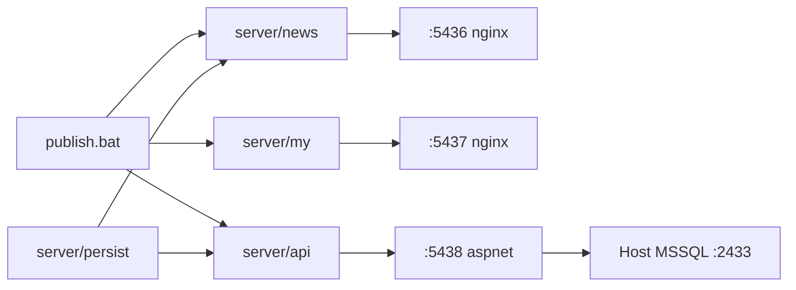

/*
 File: docs/shared/server-deploy.md
 Description: راهنمای دیپلوی پوشه server با persist روی هاست؛ CORS/FrontendUrls و triage ظاهر CORS
 Parent Dependencies: server/publish.bat, server/pre-publish-tests.bat, server/sync.config.bat, server/sync-deploy.bat, server/init-server-structure.bat
*/

> **مسیر:** [مستندات — ایندکس](../README.md) › [Shared](README.md) › دیپلوی سرور  
> **پدر:** [Shared](README.md)

# دیپلوی پوشه `server/`

آرتیفکت‌های قابل اجرا در [`server/`](../../server/) نگه داشته می‌شوند: `news`، `my`، `api`.  
دادهٔ پایدار (آپلود + ویترین) فقط زیر [`server/persist/`](../../server/persist/) روی **هاست لینوکس** می‌ماند و با rebuild کانتینر از بین نمی‌رود.  
مسیر تولید: `sudo docker compose up -d --build` در هر پوشهٔ فعال — نه `dotnet ef database update` دستی.

## نقطهٔ ورود واحد (ویندوز)

فقط [`server/publish.bat`](../../server/publish.bat) را اجرا کنید. ترتیب ثابت:

1. بارگذاری [`sync.config.bat`](../../server/sync.config.bat) (پورت، URL عمومی، `DEPLOY_REMOTE`)
2. [`pre-publish-tests.bat`](../../server/pre-publish-tests.bat) — بستن قفل DLL + Unit بک + API smoke + Vitest؛ شکست → توقف انتشار
3. [`init-server-structure.bat`](../../server/init-server-structure.bat) — اسکلت + قالب `docker-compose.yml.example` / `.env.example` / `persist/` (بدون ساخت فایل زنده)
4. [`sync-deploy.bat`](../../server/sync-deploy.bat) `all` — بیلد my/news + publish api
5. اگر `DEPLOY_REMOTE` پر باشد → `rsync` با [`deploy-rsync-exclude.txt`](../../server/deploy-rsync-exclude.txt)؛ وگرنه چاپ دستور کپی
6. چاپ خلاصهٔ موفقیت + دستورهای `docker compose` برای لینوکس؛ سپس ۲۰ ثانیه صبر با تشخیص کلید

**پایان کنسول:** خطا/تست ناموفق → `pause` (پنجره باز). موفقیت → بدون کلید پس از ۲۰ثانیه بسته؛ کلید دیگر = بستن زودتر؛ **Esc = باز بماند** تا با نتیجه کار کنید.

قبل از بیلد production، در `sync.config.bat` مقادیر `MY_PUBLIC_URL` / `NEWS_PUBLIC_URL` / `API_PUBLIC_URL` را به origin عمومی مرورگر تنظیم کنید (نه `localhost`).  
نمونهٔ فعلی bake در `sync.config`: `https://my.nafasmed.ir` — CORS همیشه از `FrontendUrls__*` روی **همان هاست** می‌آید (هر دامنهٔ فرانت).  
برای `my`: قبل از `npm run build` مقدار `VITE_API_BASE_URL=%API_PUBLIC_URL%` ست می‌شود (بدون `/api`).

**قرارداد `.env` و `docker-compose.yml`:** پکیج publish فقط `*.example` می‌سازد/می‌فرستد (`.env.example` + `docker-compose.yml.example`). فایل‌های زنده روی ویندوز ساخته نمی‌شوند و rsync با `deploy-rsync-exclude.txt` هرگز آن‌ها را overwrite نمی‌کند تا سرورهای متفاوت خراب نشوند.

**CORS / هر دامنهٔ فرانت:** `FrontendUrls__My` و `FrontendUrls__News` روی `api/.env` **همان هاست** باید دقیقاً Origin مرورگر آن استقرار باشد (مثلاً `https://my.any-domain.ir`). چند origin با `,` یا `;`. مقدار داخل `.env.example` / `sync.config` فقط نمونه است؛ عوض کردن دامنه = ویرایش env هاست + `docker compose up -d --force-recreate` (نه پچ کد و نه انتظار overwrite از publish).

`init-server-structure.bat` و `sync-deploy.bat` helper داخلی‌اند؛ مسیر اصلی اپراتور فقط `publish.bat` است. بیلد جزئی اختیاری: `sync-deploy.bat my|news|api`.  
تست جداگانه بدون بیلد: `pre-publish-tests.bat`. بای‌پس اضطراری: `set SKIP_PRE_PUBLISH_TESTS=1` قبل از `publish.bat` (هشدار در لاگ).

## دروازهٔ تست قبل‌از‌انتشار

| سوئیت | فرمان |
|-------|--------|
| Unit بک | `dotnet test backend/tests/Nabz.Infrastructure.Tests` |
| API smoke | `dotnet test backend/tests/Nabz.Api.Tests` |
| Unit فرانت | `frontend` → `npm run test:run` |

قبل از تست، پروسس‌های قفل‌کننده (`Nabz.Api`، `testhost`، …) بسته می‌شوند. ارکستراتور: [`_pre-publish-tests.ps1`](../../server/_pre-publish-tests.ps1) (از [`pre-publish-tests.bat`](../../server/pre-publish-tests.bat)).

**UX کنسول (پیش‌فرض ساکت):** فقط پیشرفت سوئیت + heartbeat هر ۵ثانیه (`… still running (Ns)`) + PASS/FAIL و گزارش نهایی. خروجی کامل restore/NU فقط در لاگ.  
دیباگ پرخروجی: `set PRE_PUBLISH_VERBOSE=1` قبل از اجرا.  
Vitest: [`_run-frontend-tests.ps1`](../../server/_run-frontend-tests.ps1) با `--reporter=dot` (بدون redirect فایل). گزارش: [`server/test-reports/`](../../server/test-reports/).  
کاتالوگ: [`unit-test-scenarios.md`](unit-test-scenarios.md)؛ ماتریس دستی: [`pre-release-test-matrix.md`](pre-release-test-matrix.md). استاندارد: [`.cursorrules`](../../.cursorrules) §4.1 و §5.

## درخت استاندارد

```
server/
  publish.bat                 # مرجع واحد انتشار
  pre-publish-tests.bat       # wrapper دروازهٔ تست
  _pre-publish-tests.ps1      # کنسول ساکت + heartbeat
  _run-frontend-tests.ps1     # Vitest helper
  sync.config.bat
  init-server-structure.bat   # helper
  sync-deploy.bat             # helper
  deploy-rsync-exclude.txt
  _templates/write-deploy-files.ps1
  test-reports/               # لاگ تست (محلی؛ rsync exclude)
  persist/
    uploads/                  # آپلودهای API
    news-data/                # دادهٔ ویترین (آینده)
  api/   # publish + Dockerfile + docker-compose.yml.example + .env.example
  my/    # dist + nginx.conf + docker-compose.yml.example + .env.example
  news/  # dist + nginx.conf + docker-compose.yml.example + .env.example
```

## جدول سرویس‌ها

| سرویس | منبع | خروجی sync | پورت هاست | کانتینر |
|--------|------|------------|-----------|---------|
| news | `frontend/news` (فعلاً اسکلت) | `server/news/dist` + nginx؛ volume `../persist/news-data` | **5436** | `adel-maryam-nabz-clinic-news` |
| my | `frontend/` | `server/my/dist` + `nginx.conf` (SPA `try_files` → `index.html`) | **5437** | `adel-maryam-nabz-clinic-my` |
| api | `backend` | `server/api/publish` + Dockerfile (+ `install-playwright-chromium.sh` → `/ms-playwright`)؛ volumes `../persist/uploads` و `../persist/news-data` | **5438→8080** | `adel-maryam-nabz-clinic-api` |

### Volumeهای پایدار (هاست → کانتینر)

| هاست | کانتینر | سرویس |
|------|---------|--------|
| `server/persist/uploads` | `/app/wwwroot/uploads` | api |
| `server/persist/news-data` | `/app/news-vitrine` | api (آینده / نوشتن) |
| `server/persist/news-data` | `/usr/share/nginx/html/data:ro` | news (خواندن) |

path داخل کانتینر ثابت است؛ فقط مسیر هاست به `persist/` است.  
named volume Docker یا کپی داخل image برای آپلود/ویترین **ممنوع**.

**خزانه فایل (UC-PLT-14):** `Storage__Root=/app/wwwroot/uploads` در `docker-compose` (`environment`) و `.env.example` قفل است تا با bind mount هم‌تراز باشد. ساختار نسبی زیر ریشه: `yyyy/NNN/file` (سال UTC آپلود / سه رقم اول کدملی بیمار).

**Triage — vault لیست دارد ولی `persist/uploads` خالی است:** ریشهٔ نوشتن اشتباه بوده (معمولاً `/app/uploads` داخل لایهٔ کانتینر). روی سرور:

```bash
sudo docker exec adel-maryam-nabz-clinic-api printenv Storage__Root
# باید /app/wwwroot/uploads باشد
sudo docker exec adel-maryam-nabz-clinic-api ls -la /app/uploads 2>/dev/null || true
# در صورت وجود فایل یتیم: یک‌بار کپی به هاست
# sudo docker cp adel-maryam-nabz-clinic-api:/app/uploads/. ./persist/uploads/
```

سپس compose را با قالب جدید up کنید و یک آپلود آزمایشی بزنید؛ فایل باید زیر `server/persist/uploads/yyyy/...` دیده شود.

MSSQL روی هاست سرور پورت **2433**؛ کانتینر API با `host.docker.internal` وصل می‌شود.



## قواعد بیلد و قالب

- قالب‌ها از [`_templates/write-deploy-files.ps1`](../../server/_templates/write-deploy-files.ps1) فقط `docker-compose.yml.example` / `.env.example` / `Dockerfile` / `nginx.conf` می‌نویسند؛ ویرایش دستی خارج از قالب ممنوع. فایل زنده compose روی هاست است.
- **SPA fallback:** `my` و `news` هر دو `nginx.conf` با `try_files $uri $uri/ /index.html` دارند تا مسیرهای کلاینت (مثل `/login`) با رفرش مستقیم 404 ندهند.
- **MIME برای `.mjs`:** هر دو `nginx.conf` برای `*.mjs` صریحاً `Content-Type: application/javascript` می‌گذارند (مثلاً worker `pdf.js`)؛ وگرنه `mime.types` قدیمی فایل را `octet-stream` می‌دهد و مرورگر ماژول را رد می‌کند. بعد از به‌روز کردن فایل روی سرور: `sudo docker compose up -d` در `server/my` (و در صورت نیاز purge کش ابرآروان برای همان asset).
- **`.env` و `docker-compose.yml` زنده** در مسیر publish ساخته/ارسال نمی‌شوند. کلید یا پورت جدید را از `*.example` دستی به فایل زنده **همان هاست** merge کنید.
- اگر `frontend/news` نباشد، sync برای news فقط **placeholder** می‌نویسد تا nginx بالا بیاید.
- **کپی فقط‌تازه‌تر:** `sync-deploy.bat` برای `my/dist` و `news/dist` از `robocopy /E /XO` بدون wipe مقصد استفاده می‌کند؛ `api/publish` هم قبل از `dotnet publish` پاک نمی‌شود. فقط منبع تازه‌تر از مقصد overwrite می‌شود؛ فایل‌های اضافی/قدیمی dest می‌مانند.

## کپی پکیج به لینوکس

فقط `*.example` (به‌همراه Dockerfile / nginx / dist / publish) ارسال می‌شود؛ `.env` و `docker-compose.yml` زنده و محتویات `persist/` روی سرور نباید overwrite شوند.

اگر `DEPLOY_REMOTE` در `sync.config.bat` پر باشد، `publish.bat` خودش rsync را با `-avu` اجرا می‌کند (`-u` = اگر مقصد جدیدتر است overwrite نشود)؛ وگرنه:

```bash
rsync -avu --exclude-from=deploy-rsync-exclude.txt ./ user@host:/path/to/server/
```

فایل exclude: [`server/deploy-rsync-exclude.txt`](../../server/deploy-rsync-exclude.txt).  
هرگز `--delete` را طوری نزنید که `persist/` یا `.env` / `docker-compose.yml` مقصد پاک شود.

## روی سرور لینوکس

1. یک‌بار در هر پوشهٔ فعال (`api` / `my` / `news`):
   ```bash
   cp .env.example .env                         # api: User Id/Password و FrontendUrls
   cp docker-compose.yml.example docker-compose.yml
   ```
   بعد فقط merge دستی از example وقتی کلید/پورت جدید آمد.
2. در هر پوشه: `sudo docker compose up -d --build`
3. API در استارت: `MigrateAsync` + seed از `IAppDataSeeder` / `AppDataSeeder` (مالک دمو `09123458910`؛ ادمین کل `09133752696`).
4. **مایگریشن:** فقط یک `Initial` (شامل `Persons`)؛ روی DB خام استارت API همان را یک‌بار اعمال + `AppDataSeeder` می‌کند. DB سرور اگر حذف شده، فقط publish و استارت کافی است. ریست بعدی: UC-PLT-13 با OTP.

### مهاجرت از layout قدیمی (یک‌بار)

اگر هنوز `api/uploads` یا `news/data` دارید:

```bash
mkdir -p persist/uploads persist/news-data
# mv api/uploads/* persist/uploads/ 2>/dev/null || true
# mv news/data/* persist/news-data/ 2>/dev/null || true
```

سپس compose جدید را up کنید. اسکریپت‌های ویندوز داده را خودکار پاک/منتقل نمی‌کنند.

### کلیدهای مهم `.env` API

| کلید | نقش |
|------|-----|
| `ConnectionStrings__NabzClinic` | MSSQL روی هاست |
| `Auth__FixedOtp` | اگر پر باشد → همان کد برای لاگین؛ **بدون درگاه پیامک** |
| `Kavenegar__ApiKey` / `OtpTemplate` / `InviteTemplate` | fallback وقتی `Clinic.SmsProvider=Kavenegar` یا None ولی env پر باشد |
| `FrontendUrls__My` / `FrontendUrls__News` | Origin(های) فرانت همین هاست برای CORS (`WithOrigins`)؛ چند تا با کاما؛ اولین `My` = پایهٔ invite_url |

### PDF پرسشنامه (UC-ADM-26) و Chromium

- `sync-deploy` API را با `-r linux-x64` publish می‌کند تا درایور `.playwright/node/linux-x64` (نه win32) داخل `api/publish` بیاید.
- Dockerfile: درایور `linux-x64` + نصب Chromium **قبل** از `COPY publish/` کامل تا deploy بعدی لایهٔ browser را `CACHED` کند. **بدون** `# syntax=docker/dockerfile` (کشیدن frontend از Docker Hub روی سرور 403 می‌شود).
- بار اول بعد از تغییر Dockerfile/نسخهٔ Playwright دانلود CDN طبیعی است؛ بدون `--no-cache` مگر عمدی.
- اسکریپت: [`api/install-playwright-chromium.sh`](../../server/api/install-playwright-chromium.sh). تأیید: `ls /ms-playwright`.

### triage: «CORS» در مرورگر vs API down

پیام DevTools «blocked by CORS / No Access-Control-Allow-Origin» لزوماً باگ سیاست نیست.

| پروب `OPTIONS` به همان URL با `Origin` فرانت | معنی | اقدام |
|-----------------------------------------------|------|--------|
| 502 / 503 / 504 / HTML از CDN (مثلاً ArvanCloud) | upstream/API در دسترس نیست | سلامت کانتینر/پورت API و edge — نه پچ `AddCors` |
| پاسخ از API بدون / با ACAO اشتباه | سیاست CORS | هم‌ترازی `FrontendUrls__*` و `UseCors` قبل از Auth |
| 204/200 + `Access-Control-Allow-Origin` درست | CORS سالم | ریشه را جای دیگر بجویید |

Smoke اجباری: `CorsPreflightSmokeTests` در `Nabz.Api.Tests` (مسیر `pre-publish-tests`).

## ماتریس OTP / SMS روی سرور

1. **`Auth__FixedOtp` پر → کد ثابت برای لاگین؛ بدون SMS تولیدی** (OTP و کمپین از `AuthService` + `ClinicRoutingSmsSender`). **تست درگاه UC-ADM-23 (`IClinicSmsDispatch`) مستقل است** و با FixedOtp هم واقعی می‌رود. در **Production** استارت API با FixedOtp غیرخالی fail می‌شود.
2. وگرنه `Clinic.SmsProvider` از تنظیمات بیمارستان (UC-ADM-21):
   - `Kavenegar` → ApiKey کلینیک یا fallback `Kavenegar__*` از env؛ قالب OTP/Invite (`%token` در پنل کاوه‌نگار).
   - `Touba` → SOAP `http://www.tsms.ir/soapWSDL/` (`UserInfo` + `sendSms`) با Username/Password/خط ارسال؛ OTP از `ToubaOtpMessageTemplate` که **باید `{code}` داشته باشد** (عدد ثابت مثل `11111` بدون placeholder رد می‌شود)؛ کمپین از `BodyPreview`.
   - `None` بدون env کاوه‌نگار → پیکربندی ناقص.
3. برای **prod:** FixedOtp خالی (`GET /api/auth/otp/mode` → `fixedOtpEnabled:false`) + درگاه کلینیک کامل. روی لوکال می‌توان با FixedOtp لاگین کرد و همزمان تست درگاه را زد.

## Seed و migrate

- migrate خودکار در استارت API (`MigrateAsync`) — پس از اسکواش معمولاً یک مایگریشن `Initial`.
- seed اولیه کلینیک نمونه و کاربران نقش‌دار در `AppDataSeeder` (`IAppDataSeeder`).
- ریست فکتوری ادمین کل (UC-PLT-13): wipe DB + پاک کردن `Storage:Root` / uploads + seed مجدد؛ نیاز به OTP.
- برای بدهی میدان ردیف «verify DebtC applied» در ماتریس تست کافی است (اعمال دستی DB خارج از scope).
- ماتریس کامل قبل‌از‌انتشار: [`pre-release-test-matrix.md`](pre-release-test-matrix.md) (شامل TC-DEP-05).

---
**ناوبری:** [پدر](README.md) · [مستندات — ایندکس](../README.md)  
**مرتبط:** [`server/publish.bat`](../../server/publish.bat) · [`pre-publish-tests.bat`](../../server/pre-publish-tests.bat) · [ماتریس تست](pre-release-test-matrix.md) · [Unit Test](unit-test-scenarios.md) · [process-changelog](process-changelog.md)
