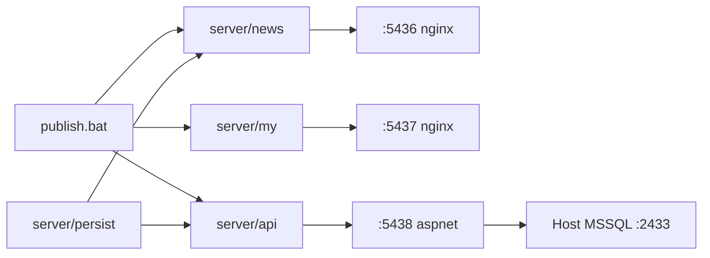

/*
 File: docs/shared/server-deploy.md
 Description: راهنمای دیپلوی پوشه server با persist روی هاست؛ مرجع ورود publish.bat
 Parent Dependencies: server/publish.bat, server/pre-publish-tests.bat, server/sync.config.bat, server/sync-deploy.bat, server/init-server-structure.bat
*/

> **مسیر:** [مستندات — ایندکس](../README.md) › [Shared](README.md) › دیپلوی سرور  
> **پدر:** [Shared](README.md)

# دیپلوی پوشه `server/`

آرتیفکت‌های قابل اجرا در [`server/`](../../server/) نگه داشته می‌شوند: `news`، `my`، `api`.  
دادهٔ پایدار (آپلود + ویترین) فقط زیر [`server/persist/`](../../server/persist/) روی **هاست لینوکس** می‌ماند و با rebuild کانتینر از بین نمی‌رود.  
مسیر تولید: `sudo docker compose up -d --build` در هر پوشهٔ فعال — نه `dotnet ef database update` دستی.

## نقطهٔ ورود واحد (ویندوز)

فقط [`server/publish.bat`](../../server/publish.bat) را اجرا کنید. ترتیب ثابت:

1. بارگذاری [`sync.config.bat`](../../server/sync.config.bat) (پورت، URL عمومی، `DEPLOY_REMOTE`)
2. [`pre-publish-tests.bat`](../../server/pre-publish-tests.bat) — بستن قفل DLL + Unit بک + API smoke + Vitest؛ شکست → توقف انتشار
3. [`init-server-structure.bat`](../../server/init-server-structure.bat) — اسکلت + قالب compose / `.env.example` / `persist/`
4. [`sync-deploy.bat`](../../server/sync-deploy.bat) `all` — بیلد my/news + publish api
5. اگر `DEPLOY_REMOTE` پر باشد → `rsync` با [`deploy-rsync-exclude.txt`](../../server/deploy-rsync-exclude.txt)؛ وگرنه چاپ دستور کپی
6. چاپ دستورهای `docker compose` برای اجرا روی لینوکس

قبل از بیلد production، در `sync.config.bat` مقادیر `MY_PUBLIC_URL` / `NEWS_PUBLIC_URL` / `API_PUBLIC_URL` را به origin عمومی مرورگر تنظیم کنید (نه `localhost`).  
برای `my`: قبل از `npm run build` مقدار `VITE_API_BASE_URL=%API_PUBLIC_URL%` ست می‌شود (بدون `/api`).

`init-server-structure.bat` و `sync-deploy.bat` helper داخلی‌اند؛ مسیر اصلی اپراتور فقط `publish.bat` است. بیلد جزئی اختیاری: `sync-deploy.bat my|news|api`.  
تست جداگانه بدون بیلد: `pre-publish-tests.bat`. بای‌پس اضطراری: `set SKIP_PRE_PUBLISH_TESTS=1` قبل از `publish.bat` (هشدار در لاگ).

## دروازهٔ تست قبل‌از‌انتشار

| سوئیت | فرمان |
|-------|--------|
| Unit بک | `dotnet test backend/tests/Nabz.Infrastructure.Tests` |
| API smoke | `dotnet test backend/tests/Nabz.Api.Tests` |
| Unit فرانت | `frontend` → `npm run test:run` |

قبل از تست، پروسس‌های قفل‌کننده (`Nabz.Api`، `testhost`، …) بسته می‌شوند. ارکستراتور: [`_pre-publish-tests.ps1`](../../server/_pre-publish-tests.ps1) (از [`pre-publish-tests.bat`](../../server/pre-publish-tests.bat)).

**UX کنسول (پیش‌فرض ساکت):** فقط پیشرفت سوئیت + heartbeat هر ۵ثانیه (`… still running (Ns)`) + PASS/FAIL و گزارش نهایی. خروجی کامل restore/NU فقط در لاگ.  
دیباگ پرخروجی: `set PRE_PUBLISH_VERBOSE=1` قبل از اجرا.  
Vitest: [`_run-frontend-tests.ps1`](../../server/_run-frontend-tests.ps1) با `--reporter=dot` (بدون redirect فایل). گزارش: [`server/test-reports/`](../../server/test-reports/).  
کاتالوگ: [`unit-test-scenarios.md`](unit-test-scenarios.md)؛ ماتریس دستی: [`pre-release-test-matrix.md`](pre-release-test-matrix.md). استاندارد: [`.cursorrules`](../../.cursorrules) §4.1 و §5.

## درخت استاندارد

```
server/
  publish.bat                 # مرجع واحد انتشار
  pre-publish-tests.bat       # wrapper دروازهٔ تست
  _pre-publish-tests.ps1      # کنسول ساکت + heartbeat
  _run-frontend-tests.ps1     # Vitest helper
  sync.config.bat
  init-server-structure.bat   # helper
  sync-deploy.bat             # helper
  deploy-rsync-exclude.txt
  _templates/write-deploy-files.ps1
  test-reports/               # لاگ تست (محلی؛ rsync exclude)
  persist/
    uploads/                  # آپلودهای API
    news-data/                # دادهٔ ویترین (آینده)
  api/   # publish + Dockerfile + compose + .env.example
  my/    # dist + compose + .env.example
  news/  # dist + nginx.conf + compose + .env.example
```

## جدول سرویس‌ها

| سرویس | منبع | خروجی sync | پورت هاست | کانتینر |
|--------|------|------------|-----------|---------|
| news | `frontend/news` (فعلاً اسکلت) | `server/news/dist` + nginx؛ volume `../persist/news-data` | **5436** | `adel-maryam-nabz-clinic-news` |
| my | `frontend/` | `server/my/dist` + nginx | **5437** | `adel-maryam-nabz-clinic-my` |
| api | `backend` | `server/api/publish` + Dockerfile؛ volumes `../persist/uploads` و `../persist/news-data` | **5438→8080** | `adel-maryam-nabz-clinic-api` |

### Volumeهای پایدار (هاست → کانتینر)

| هاست | کانتینر | سرویس |
|------|---------|--------|
| `server/persist/uploads` | `/app/wwwroot/uploads` | api |
| `server/persist/news-data` | `/app/news-vitrine` | api (آینده / نوشتن) |
| `server/persist/news-data` | `/usr/share/nginx/html/data:ro` | news (خواندن) |

path داخل کانتینر ثابت است؛ فقط مسیر هاست به `persist/` است.  
named volume Docker یا کپی داخل image برای آپلود/ویترین **ممنوع**.

MSSQL روی هاست سرور پورت **2433**؛ کانتینر API با `host.docker.internal` وصل می‌شود.



## قواعد بیلد و قالب

- قالب‌ها از [`_templates/write-deploy-files.ps1`](../../server/_templates/write-deploy-files.ps1) refresh می‌شوند؛ ویرایش دستی compose/Dockerfile خارج از قالب ممنوع.
- **`.env` موجود API بازنویسی نمی‌شود.** کلید جدید در `.env.example` را دستی به `.env` سرور اضافه کنید.
- اگر `frontend/news` نباشد، sync برای news فقط **placeholder** می‌نویسد تا nginx بالا بیاید.

## کپی پکیج به لینوکس

فقط `.env.example` ارسال می‌شود؛ `.env` پرشده و محتویات `persist/` روی سرور نباید overwrite شوند.

اگر `DEPLOY_REMOTE` در `sync.config.bat` پر باشد، `publish.bat` خودش rsync را اجرا می‌کند؛ وگرنه:

```bash
rsync -av --exclude-from=deploy-rsync-exclude.txt ./ user@host:/path/to/server/
```

فایل exclude: [`server/deploy-rsync-exclude.txt`](../../server/deploy-rsync-exclude.txt).  
هرگز `--delete` را طوری نزنید که `persist/` یا `.env` مقصد پاک شود.

## روی سرور لینوکس

1. یک‌بار داخل `server/api`: `cp .env.example .env` و پر کردن `User Id` / `Password` و در صورت نیاز `Auth__FixedOtp` / کلید کاوه‌نگار.
2. در هر پوشهٔ فعال (`api` / `my` / `news`): `sudo docker compose up -d --build`
3. API در استارت: `MigrateAsync` + seed (مالک دمو `09123458910` و نقش‌های seed در `Program.cs`).

### مهاجرت از layout قدیمی (یک‌بار)

اگر هنوز `api/uploads` یا `news/data` دارید:

```bash
mkdir -p persist/uploads persist/news-data
# mv api/uploads/* persist/uploads/ 2>/dev/null || true
# mv news/data/* persist/news-data/ 2>/dev/null || true
```

سپس compose جدید را up کنید. اسکریپت‌های ویندوز داده را خودکار پاک/منتقل نمی‌کنند.

### کلیدهای مهم `.env` API

| کلید | نقش |
|------|-----|
| `ConnectionStrings__NabzClinic` | MSSQL روی هاست |
| `Auth__FixedOtp` | اگر پر باشد → همان کد برای لاگین؛ **بدون کاوه‌نگار** |
| `Kavenegar__ApiKey` / `OtpTemplate` / `InviteTemplate` | وقتی Fixed خالی است |
| `FrontendUrls__My` / `FrontendUrls__News` | مستندسازی URL فرانت (CORS آینده) |

## ماتریس OTP / SMS روی سرور

1. `Auth__FixedOtp` پر → کد ثابت؛ SMS ارسال نمی‌شود.
2. وگرنه اگر `Kavenegar__ApiKey` خالی → ارسال SMS شکست می‌خورد (پیکربندی ناقص).
3. وگرنه → قالب OTP/Invite با کلید واقعی.

برای **prod عمومی واقعی:** `Auth__FixedOtp` خالی + ApiKey و `OtpTemplate` واقعی.

## Seed و migrate

- migrate خودکار در استارت API (`MigrateAsync`).
- seed اولیه کلینیک نمونه و کاربران نقش‌دار در `Program.cs`.
- برای بدهی میدان ردیف «verify DebtC applied» در ماتریس تست کافی است (اعمال دستی DB خارج از scope).
- ماتریس کامل قبل‌از‌انتشار: [`pre-release-test-matrix.md`](pre-release-test-matrix.md) (شامل TC-DEP-05).

---
**ناوبری:** [پدر](README.md) · [مستندات — ایندکس](../README.md)  
**مرتبط:** [`server/publish.bat`](../../server/publish.bat) · [`pre-publish-tests.bat`](../../server/pre-publish-tests.bat) · [ماتریس تست](pre-release-test-matrix.md) · [Unit Test](unit-test-scenarios.md) · [process-changelog](process-changelog.md)
